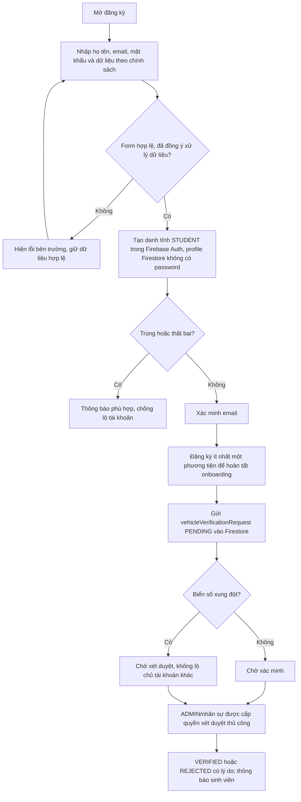
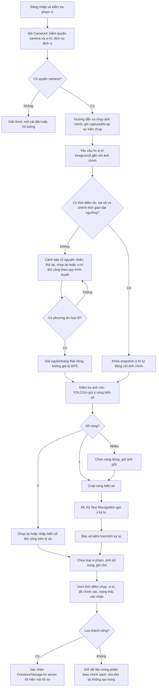

# 03 — Luồng người dùng và ngoại lệ

> Đây là luồng mục tiêu `PLANNED`; Navigation Graph hiện rỗng tại [`nav_graph.xml`](../app/src/main/res/navigation/nav_graph.xml). Các nhánh phụ thuộc quyết định `OPEN` được nêu rõ. Trạng thái giao diện chung: loading, empty, success, error, offline, permission denied theo [UI/UX](07-UI-UX-GUIDELINES.md).

## Sinh viên: đăng ký và quản lý xe

Số điện thoại là liên hệ tùy chọn và **chưa xác minh** trên Firebase Spark: form không có bước SMS OTP; nếu để trống vẫn tiếp tục, nếu cung cấp phải hiện nhãn chưa xác minh và không dùng làm định danh đăng nhập/khôi phục. Email phải được Firebase Auth xác minh trước bước đăng ký xe. Mã sinh viên chỉ thu nếu có nguồn xác minh được duyệt. Khi mất mạng lúc đăng ký, không thông báo đã tạo tài khoản/profile/xe nếu chưa có xác nhận server. Tài khoản Auth tạo xong nhưng profile Firestore chưa hoàn tất cần trạng thái phục hồi, không tạo vai trò ADMIN. Hai yêu cầu cùng biển số có thể cùng `PENDING`; **duyệt `VERIFIED`** phải bảo đảm chỉ một claim hiệu lực bằng transaction/backend đáng tin cậy. Không chuyển hồ sơ cũ cho chủ mới. Xem [Requirements](01-PRODUCT-REQUIREMENTS.md), [Database](04-DATABASE-DESIGN.md), DEC-004/007 tại [Decision Log](15-DECISION-LOG.md).

## Bảo vệ: ghi nhận vi phạm

Không phát hiện biển số: cho chụp lại/nhập tay, không đặt biển số giả. Nhiều biển số: người dùng chọn vùng, không lấy mặc định confidence cao nhất. OCR không hợp lệ: hiển thị nguyên gợi ý để đối chiếu, đánh dấu nguồn `MANUAL_CORRECTION`. Ảnh mờ: yêu cầu ảnh khác nếu không đủ bằng chứng. Quyền vị trí bị từ chối, dịch vụ tắt, timeout, fix quá cũ hoặc sai số lớn: cảnh báo, không ghi `0,0`, không tự lấy vị trí khi lưu; cho thử lại/chụp lại hoặc chọn khu vực thủ công **nếu DEC-008A duyệt**. Khi thoát trước xác nhận: hỏi lưu/hủy bản nháp, xóa ảnh tạm theo chính sách. Lưu thất bại: trạng thái chưa gửi và mã idempotency, không tạo trùng khi retry.

**Ảnh chính và nhiều ảnh:** ảnh chụp đầu tiên được chọn làm ảnh chính, có `primaryEvidenceId`, `capturedAt` và snapshot vị trí riêng. Ảnh bổ sung có thời điểm/metadata riêng và không thay snapshot vị trí hồ sơ. Nếu đổi ảnh chính, bảo vệ phải chọn tường minh; hệ thống rà lại vị trí của ảnh mới, hiển thị thay đổi, và ghi audit nếu hồ sơ đã lưu. Nếu bảo vệ di chuyển sau ảnh chính, vị trí đo muộn không được gắn ngược vào ảnh cũ khi vượt ngưỡng chênh thời gian; phải chụp lại hoặc theo ngoại lệ thủ công đã duyệt.

## Sinh viên: tra cứu hồ sơ

Đăng nhập → xác minh phiên → xem xe đã liên kết → chọn vi phạm được dịch vụ **phân quyền theo liên kết đã duyệt và thời gian hiệu lực** → xem ảnh/thời gian/khu vực/trạng thái. Xe `PENDING`, `REJECTED`, `INACTIVE`, xung đột biển số hoặc vi phạm trước `validFrom` không cấp quyền tự động. Danh sách rỗng nói rõ “chưa có hồ sơ được phép hiển thị”; lỗi mạng có nút thử lại, cache nếu có phải tuân quyền và chính sách. Đường dẫn trực tiếp tới hồ sơ/ảnh ngoài quyền bị từ chối. Gửi yêu cầu xem xét lại là luồng `PROPOSED`, chỉ xuất hiện sau phê duyệt sản phẩm.

## Quản trị và xử lý tranh chấp

Trong **ứng dụng Android ADMIN**, người có quyền xem hàng chờ xác minh → kiểm tra bằng chứng theo mức tối thiểu → phát hiện trùng biển số → đối chiếu thời gian/quyền sử dụng, yêu cầu bổ sung khi thiếu → duyệt/từ chối có lý do và audit. Khi duyệt, nguồn đáng tin cậy giữ một `plateClaim` hoạt động bằng transaction; request trùng bị từ chối/chuyển hàng tranh chấp, không lộ chủ xe khác. Khi chuyển nhượng: đóng liên kết cũ, tạo liên kết mới; không sửa lịch sử vi phạm cũ. Với hồ sơ vi phạm đã xác nhận: chỉnh sửa bằng phiên bản/sự kiện sửa, không ghi đè ảnh gốc; thay đổi trạng thái cần quyền và lý do.

## Trạng thái hệ thống và phục hồi

| Tình huống | Phản hồi và hành động |
|---|---|
| Camera bị từ chối | Nêu lý do cần quyền, hướng tới cài đặt nếu từ chối lâu dài; không lặp hộp thoại liên tục. |
| Từ chối quyền vị trí/chỉ cấp approximate | Giải thích yêu cầu chất lượng, thử xin quyền foreground phù hợp; nếu không đạt, chụp lại hoặc quy trình thủ công đã duyệt; không nói ảnh có GPS hợp lệ. |
| Dịch vụ định vị tắt | Hướng dẫn bật dịch vụ qua cài đặt hệ thống rồi thử lại; không tự bật hoặc dùng fix cũ. |
| Fix cũ, độ chính xác thấp (sai số lớn), timeout | Hiện `locationStatus` và nguyên nhân cụ thể; thử lấy lại/chụp lại/thủ công theo DEC-008A; không thay bằng vị trí lúc lưu. |
| Nhiều ảnh hoặc bảo vệ di chuyển | Ảnh bổ sung không ghi đè vị trí ảnh chính; đổi ảnh chính cần thao tác rõ và kiểm lại khoảng lệch thời gian. |
| Không Internet | Hiển thị offline; bản đầu online-first không xác nhận nộp hồ sơ khi chưa có xác nhận server. Cache Firestore không đồng nghĩa hồ sơ đã lưu chính thức. |
| Hết phiên/bị thu quyền | Dừng gửi bản nháp, yêu cầu đăng nhập lại, xóa cache nhạy cảm theo chính sách. |
| Upload ảnh xong nhưng ghi metadata lỗi | Đánh dấu giao dịch chưa hoàn tất, thử lại hoặc dọn ảnh mồ côi theo chính sách; không công bố hồ sơ nửa vời. |
| Người dùng rời form | Hỏi lưu bản nháp/hủy; nếu hủy, xử lý ảnh tạm theo thời hạn đã duyệt. |
