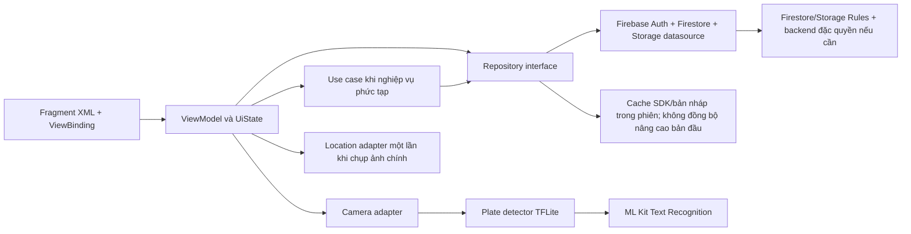

# 05 — Kiến trúc hệ thống

> Kiến trúc mục tiêu đã chốt Firebase Authentication + Cloud Firestore + Firebase Cloud Storage, ML Kit OCR, ADMIN trong app và online-first theo ADR-001..005; **mới có enum, POJO và datasource email Auth, chưa có luồng đăng ký/tích hợp Firestore chạy được**. Kiến trúc hiện tại có một `MainActivity`, `data/model`, một `data/datasource`, resource XML và asset; xem [hiện trạng](13-CURRENT-PROJECT-STATUS.md). Không tự tái cấu trúc toàn bộ dự án theo sơ đồ này.

## Hiện tại và hướng mục tiêu

Hiện tại `MainActivity` nạp ViewBinding và XML NavHost; [`nav_graph.xml`](../app/src/main/res/navigation/nav_graph.xml) chưa có destination. Model chứa dữ liệu; [`FirebaseEmailAuthDataSource.java`](../app/src/main/java/com/example/parkguardai/data/datasource/FirebaseEmailAuthDataSource.java) gọi Auth email nhưng chưa có ViewModel/repository, Firebase Project hoặc hồ sơ Firestore. TensorFlow Lite có dependency và asset nhưng không có pipeline. Tài liệu này xác định ranh giới để phát triển từng lát chức năng nhỏ, không khẳng định backend hoặc Room đã được chọn.

## Trách nhiệm đề xuất theo package

| Package/lớp | Trách nhiệm | Điều không nên đặt tại đây |
|---|---|---|
| `ui/...` Activity/Fragment, XML | Render `UiState`, nhận click, điều hướng, lỗi tại trường, quyền runtime; binding theo vòng đời view | Truy vấn trực tiếp dữ liệu nhạy cảm hoặc suy luận AI trên UI thread |
| `ui/.../ViewModel` | Giữ loading/empty/error/offline, điều phối tác vụ, phát sự kiện một lần, hủy tác vụ theo lifecycle | Giữ `View`, Activity context, bitmap lớn/ảnh gốc lâu dài |
| `domain/...` nếu cần | Quy tắc chuẩn hóa biển số, chuyển trạng thái, kiểm tra khoảng thời gian liên kết, idempotency | Framework Android hoặc request mạng cụ thể |
| `data/repository/...` | Giao diện dữ liệu có ý nghĩa nghiệp vụ; kết hợp remote/local, phân loại lỗi, đồng bộ khi được duyệt | Tự cấp quyền thay backend |
| `data/datasource/...` | Gọi Firebase Auth, Firestore và Storage, phân biệt server/cache/ảnh upload; offline nâng cao để sau | Quyết định UI hoặc quyền dựa trên dữ liệu client tự khai |
| `ai/...` | Kiểm tra metadata model, tiền xử lý, suy luận, hậu xử lý, giải phóng interpreter | Quyết định loại vi phạm/chủ xe |
| `camera/...` | Bind/unbind CameraX, capture/analyze, chuyển đổi frame, close `ImageProxy` | Lưu hồ sơ vi phạm |
| `location/...` | Kiểm quyền foreground/cài đặt định vị; lấy một fix khi chụp ảnh chính, đo tuổi/chênh thời gian/độ chính xác, tạo snapshot nguồn/trạng thái và xử lý từ chối | Theo dõi nền, lấy `lastLocation` không kiểm tuổi, tự thay fix lúc lưu hồ sơ |
| `security/...` nếu cần | Quản lý phiên/kiểm tra quyền phía client để UX; backend vẫn là nguồn thực thi | Coi vai trò từ Intent/Preferences là quyền tin cậy |

Không tạo package mới chỉ vì tên xuất hiện trong bảng. Tạo khi có chức năng thực tế và test phù hợp. Giữ package gốc `com.example.parkguardai` trừ khi có quyết định riêng.

## Luồng dữ liệu vi phạm và ranh giới tin cậy

1. Camera lấy **ảnh chính** dưới quyền runtime; ghi `capturedAt` từ sự kiện chụp/metadata đáng tin đã kiểm thử. Đồng thời yêu cầu fix vị trí foreground, không đợi tới khi lưu hồ sơ. `Location` adapter trả một snapshot có tọa độ, `locationAccuracy`, `locationTimestamp`, nguồn và trạng thái. Nếu không đạt ngưỡng hoặc không có quyền/dịch vụ, UI cảnh báo và mở đường thử lại/chụp lại/thủ công đã duyệt. Camera/AI tiếp tục sinh gợi ý bounding box và OCR; bảo vệ chỉnh biển số cuối.
2. ViewModel giữ ID ảnh chính bất biến trong bản nháp và trạng thái vị trí của **ảnh đó**. UI rà soát ảnh, thời điểm chụp, vị trí/độ chính xác/trạng thái, loại vi phạm và biển số. Ảnh bổ sung có metadata riêng; không thay vị trí ảnh chính. Đổi ảnh chính là sự kiện tường minh cần kiểm lại snapshot.
3. Repository gửi ảnh vào Cloud Storage theo đường dẫn riêng và metadata/hồ sơ vào Firestore với mã idempotency. Rules hoặc nghiệp vụ backend tin cậy kiểm tra Firebase Auth UID, vai trò/phạm vi, định dạng, `primaryEvidenceId`, quan hệ ảnh-vị trí và trạng thái ngoại lệ đã duyệt; `guardId` từ phiên tin cậy. Upload Storage và transaction Firestore không chung một giao dịch nên cần trạng thái hoàn tất, dọn ảnh mồ côi và chỉ báo thành công khi server xác nhận cả hai theo chính sách.
4. Dữ liệu trả về được phân trang theo quyền. Khi sinh viên truy vấn, tầng dữ liệu kiểm tra `VehicleLink` đã xác minh và khoảng thời gian, không chỉ so biển số.
5. Mọi thay đổi có sự kiện audit; ảnh gốc không bị sửa trực tiếp. Bản đầu online-first: cache mặc định Firestore có thể phục vụ đọc/ghi cục bộ, nhưng UI phải tách `chưa xác nhận server` và `đã lưu server`; không xây queue đồng bộ nghiệp vụ phức tạp. [Firestore offline persistence](https://firebase.google.com/docs/firestore/manage-data/enable-offline) nêu cache Android mặc định và đồng bộ thay đổi, [Firestore transactions](https://firebase.google.com/docs/firestore/manage-data/transactions) nêu transaction thất bại khi offline.

**Đo độ mới của fix:** Fused Location Provider `getCurrentLocation()` có thể trả vị trí cache; `getLastLocation()` là cache và có thể rất cũ. Vì vậy cấu hình `CurrentLocationRequest` phải nêu rõ tuổi tối đa/timeout và **luôn kiểm thực tế** `Location.getElapsedRealtimeNanos()` với mốc chụp trên cùng boot, cùng `hasAccuracy()/getAccuracy()`; persist UTC `locationTimestamp` cho hiển thị/audit. Chỉ số sai số là ước tính ngang, không phải bằng chứng tọa độ tuyệt đối. [FusedLocationProviderClient](https://developers.google.com/android/reference/com/google/android/gms/location/FusedLocationProviderClient), [CurrentLocationRequest.Builder](https://developers.google.com/android/reference/com/google/android/gms/location/CurrentLocationRequest.Builder), [Android Location](https://developer.android.com/reference/android/location/Location). Ngưỡng cụ thể và nguồn timestamp chụp là DEC-008A.

## Navigation, trạng thái và lỗi

Giữ single Activity + NavHost hiện có. Màn hình theo vai trò chỉ được xây sau wireframe và xác nhận luồng; graph cần start destination hợp lệ, điều hướng sau xác thực không là cơ chế phân quyền. `UiState` nên mô tả loading/content/empty/error/offline/permission denied, với dữ liệu và lỗi trường riêng. Ánh xạ lỗi dữ liệu thành thông báo cụ thể bằng `strings.xml`; không lộ raw exception cho người dùng. Tác vụ camera/AI/network phải chạy ngoài UI thread, có hủy và đóng tài nguyên đúng vòng đời. [Android ViewModel cho Views](https://developer.android.com/topic/libraries/architecture/views/viewmodel) lưu ý tránh giữ tham chiếu View/Activity context; [Android Navigation với Fragment](https://developer.android.com/guide/navigation/design) mô tả NavHostFragment cho View System.

## Firebase và ranh giới đặc quyền

Firebase Auth quản lý danh tính/password (Firestore không chứa password). Firestore giữ profile, xe, yêu cầu duyệt, liên kết, hồ sơ, loại vi phạm và audit; Storage giữ bytes ảnh. Security Rules cho cả Firestore/Storage mặc định từ chối, kiểm UID/role/scope/path; query phải khớp Rules. ADMIN có màn hình riêng trong ứng dụng nhưng **không tự được cấp quyền**. Custom claims chỉ do Admin SDK trong môi trường đặc quyền đặt; kiểm scope/thu quyền cần thiết kế tiếp. [Firebase custom claims](https://firebase.google.com/docs/auth/admin/custom-claims), [Rules queries](https://firebase.google.com/docs/firestore/security/rules-query).

Các thao tác cấp role, duyệt xe và `plateClaims` nguyên tử, chuyển nhượng, audit tin cậy và projection hồ sơ sinh viên có thể cần backend đặc quyền (Cloud Functions hoặc môi trường server khác, **chưa chọn**). Quyết định vị trí/vận hành/chi phí backend, tài khoản dịch vụ và vùng dữ liệu là việc cần phê duyệt trước cấu hình thật. Không tự tạo Firebase Project, tải file cấu hình hoặc cài dependency ở giai đoạn tài liệu. Schema và index đề xuất ở [04](04-DATABASE-DESIGN.md), bảo mật ở [09](09-SECURITY-PRIVACY.md).
