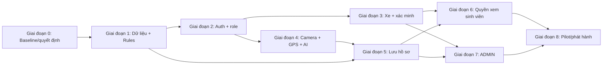

# 16 — Kế hoạch task từ hiện trạng đến sản phẩm hoàn chỉnh

> Cập nhật 2026-10-02. Đây là **backlog để theo dõi và lần lượt phê duyệt**, không phải lệnh triển khai toàn bộ, không phải báo cáo Sprint đã hoàn thành. `P0` là điều kiện cho pilot an toàn, `P1` là điều kiện phát hành sản phẩm đầy đủ theo phạm vi hiện được nêu, `P2` là mở rộng chỉ làm khi được duyệt. Đối chiếu [hiện trạng có bằng chứng](13-CURRENT-PROJECT-STATUS.md), [yêu cầu](01-PRODUCT-REQUIREMENTS.md), [roadmap mốc lớn](12-DEVELOPMENT-ROADMAP.md) và [quyết định](15-DECISION-LOG.md) trước khi nhận task. Mỗi task chỉ chuyển sang `DONE` sau khi có mã/tài liệu, kiểm thử và bằng chứng nghiệm thu tương ứng.

## 1. Điểm xuất phát và phạm vi hoàn thành

| Hạng mục | Trạng thái hiện tại và bằng chứng | Việc còn lại |
|---|---|---|
| Khung Android | `PARTIAL`: [MainActivity](../app/src/main/java/com/example/parkguardai/MainActivity.java) và [NavHost/graph](../app/src/main/res/navigation/nav_graph.xml); graph chưa có destination nghiệp vụ | Kiểm build/khởi chạy, thiết kế và nối điều hướng ba vai trò |
| Mô hình dữ liệu | `PARTIAL`: POJO cũ cùng [UserProfile](../app/src/main/java/com/example/parkguardai/data/model/UserProfile.java), [VehicleRecord](../app/src/main/java/com/example/parkguardai/data/model/VehicleRecord.java), [ViolationRecord](../app/src/main/java/com/example/parkguardai/data/model/ViolationRecord.java) và các model hỗ trợ | Chốt schema, mapping, validation, repository, migration; class không tự tạo ràng buộc Firestore |
| Xác thực | `PARTIAL`: [FirebaseEmailAuthDataSource](../app/src/main/java/com/example/parkguardai/data/datasource/FirebaseEmailAuthDataSource.java), Auth dependency trong [Gradle](../app/build.gradle.kts) | Cấu hình môi trường được phép, Rules, hồ sơ Firestore, form, xác minh email, phục hồi tài khoản |
| Xe và quyền | `PLANNED` về nghiệp vụ; [UserRole](../app/src/main/java/com/example/parkguardai/data/model/UserRole.java) có cả ba enum | Backend tin cậy, cấp/thu quyền, đăng ký nhiều xe, duyệt xe, claim biển số, lịch sử liên kết |
| Camera/AI/GPS | `PARTIAL` ở asset [YOLO11n](../app/src/main/assets/parkguard_yolo11n_best.tflite) và TFLite dependency; CameraX, ML Kit, GPS chưa có mã | Đo tensor, chụp ảnh chính, fix vị trí, detector, OCR, xác nhận thủ công |
| Hồ sơ, tra cứu, quản trị | `PLANNED`: chưa có Firestore/Storage datasource, Rules hay màn hình nghiệp vụ; xem [kiểm kê](13-CURRENT-PROJECT-STATUS.md) | Lưu nhất quán, lịch sử, quyền xem sinh viên, quản trị, audit, báo cáo |
| Kiểm thử/phát hành | `UNKNOWN`: chưa xác minh build và thiết bị; hiện có test mẫu tại `app/src/test` và `app/src/androidTest` | Thiết lập môi trường, test nghiệp vụ/Rules/thiết bị, pilot và phê duyệt phát hành |

**Định nghĩa “sản phẩm hoàn chỉnh” trong file này:** ba vai trò dùng được các luồng `P0`/`P1` đã được duyệt; dữ liệu và ảnh có quyền truy cập được kiểm bằng Rules/backend; vị trí ảnh chính có provenance; AI chỉ gợi ý; có hướng dẫn vận hành, kiểm thử thực địa, chính sách dữ liệu, bản build phát hành và phê duyệt của chủ dự án. Tính năng `P2` như yêu cầu xem xét lại, đồng bộ offline nâng cao hoặc OTP SMS không nằm trong điều kiện hoàn thành nếu chưa có quyết định mới. Không tự đánh dấu `DONE` dựa trên việc có class hoặc dependency.

## 2. Cách đọc và cập nhật backlog

- Trạng thái task: `TODO` (chưa làm), `BLOCKED` (thiếu quyết định/đầu vào), `IN_PROGRESS`, `REVIEW`, `DONE`. Tất cả task bên dưới khởi đầu là `TODO`; task có cổng quyết định mở được xem là `BLOCKED` khi định triển khai phần phụ thuộc. Không suy ra tiến độ Sprint từ bảng này. Tiền tố `P` trong mã `P00.01` có nghĩa là **plan task**, không phải mức ưu tiên `P0/P1/P2`; ưu tiên nghiệp vụ lấy từ [01](01-PRODUCT-REQUIREMENTS.md).
- Cỡ việc tham khảo: `S` khoảng một thay đổi nhỏ có thể review riêng; `M` gồm một lát chức năng và test; `L` nên tách tiếp khi bắt đầu. Đây là độ phức tạp tương đối, **không phải cam kết ngày công**.
- Mỗi hàng nêu **đầu ra**, **phụ thuộc/cổng**, **kiểm tra hoàn thành** và **khu vực file dự kiến**. Đường dẫn thư mục trong cột “Khu vực” là mục tiêu thiết kế, không khẳng định thư mục hiện có. Khi nhận task phải kiểm `git status`, diff và cấu trúc thật, rồi xác định file chính xác.
- Mỗi task giao diện cần wireframe, trạng thái loading/empty/error/offline/permission và duyệt UI theo [07](07-UI-UX-GUIDELINES.md) **trước khi tạo XML**. Mỗi dependency mới cần nêu lý do, phương án, chi phí và tác động để phê duyệt. Không tự tạo Firebase Project/config thật, không tự `git add/commit/push`.
- `DONE` chỉ khi: tiêu chí hàng tương ứng đạt; test cần thiết có kết quả thực; không lộ bí mật/PII; tài liệu trạng thái và [Decision Log](15-DECISION-LOG.md) được cập nhật nếu có quyết định; diff được review. Không có môi trường để test thì ghi `UNKNOWN`, không đánh dấu hoàn thành toàn bộ.

## 3. Giải thích cấu trúc thư mục

### 3.1. Cây hiện có (rút gọn, đã kiểm tra)

```text
ParkGuardAI/
├── AGENTS.md                         Quy tắc làm việc cho AI Coding Agent
├── docs/                             Đặc tả, kiến trúc, roadmap và quyết định
├── app/
│   ├── build.gradle.kts              Cấu hình Android app và dependency
│   ├── proguard-rules.pro             Quy tắc shrink/obfuscate khi cấu hình release
│   └── src/
│       ├── main/
│       │   ├── AndroidManifest.xml    Khai báo app, Activity và quyền
│       │   ├── assets/                Model TFLite hiện có
│       │   ├── java/com/example/parkguardai/
│       │   │   ├── MainActivity.java  Điểm vào app
│       │   │   └── data/
│       │   │       ├── model/         POJO/enum hiện có; chưa phải persistence hoàn chỉnh
│       │   │       └── datasource/    Hiện có FirebaseEmailAuthDataSource
│       │   └── res/
│       │       ├── layout/            Hiện chỉ có activity_main.xml
│       │       ├── navigation/        Graph hiện chưa có destination nghiệp vụ
│       │       ├── values/            Chuỗi, màu, theme cơ bản
│       │       ├── values-night/      Theme tối
│       │       ├── drawable/          Tài nguyên hình/vector
│       │       ├── mipmap-*/          Biểu tượng ứng dụng
│       │       └── xml/               Quy tắc backup/data extraction mẫu
│       ├── test/java/                 Unit test JVM mẫu
│       └── androidTest/java/          Instrumentation test mẫu
├── gradle/libs.versions.toml         Version catalog
├── gradle/wrapper/                   Gradle Wrapper
├── build.gradle.kts                  Cấu hình build cấp project
└── settings.gradle.kts               Danh sách module/repository
```

`app/build/` và `.gradle/` là đầu ra/caches build, không phải mã nghiệp vụ. `.idea/`, `.agents/`, `.gemini/`, `.codex/` là cấu hình công cụ hoặc workspace; kiểm [Git workflow](10-GIT-WORKFLOW.md) và `.gitignore` trước khi đề xuất đưa file vào Git. Cây rút gọn không liệt kê từng ảnh/icon và không thay cho `rg --files` khi bắt đầu task.

### 3.2. Cây mục tiêu theo trách nhiệm (**PROPOSED**, tạo dần khi có task)

```text
app/src/main/java/com/example/parkguardai/
├── ui/
│   ├── auth/           Đăng ký, đăng nhập, xác minh email, khôi phục
│   ├── student/        Home, hồ sơ, xe, vi phạm của sinh viên
│   ├── guard/          Camera, rà biển số, lập/lịch sử hồ sơ
│   ├── admin/          Dashboard, duyệt xe, người dùng, hồ sơ, danh mục, audit
│   └── common/         Thành phần UI/trạng thái dùng chung khi thực sự tái sử dụng
├── data/
│   ├── model/          DTO/POJO ánh xạ dữ liệu; không giữ mật khẩu
│   ├── datasource/     Firebase Auth/Firestore/Storage và nguồn dữ liệu cụ thể
│   ├── repository/     API dữ liệu theo nghiệp vụ, gom datasource và ánh xạ lỗi
│   └── mapper/         Chỉ tạo khi mapping POJO cũ/schema mới cần tách riêng
├── domain/             Chuẩn hóa biển, quy tắc trạng thái/khoảng hiệu lực thuần Java
├── camera/             Bind lifecycle, chụp và quản lý ảnh tạm
├── ai/                 TFLite detector, crop, ML Kit OCR, kết quả gợi ý
├── location/           Fix foreground gắn với ảnh chính, kiểm độ mới/sai số
└── security/           Trạng thái phiên/quyền cho UX; Rules/backend mới thực thi quyền

app/src/main/res/
├── layout/             Mỗi màn hình/component XML được duyệt
├── navigation/         Luồng vào và destination theo vai trò
├── values/             strings.xml, colors.xml, themes.xml, kích thước nếu cần
├── values-night/       Biến thể tối
├── drawable/           Vector, shape, minh họa có nguồn/quyền sử dụng
└── xml/                Backup/data extraction và cấu hình Android hợp lệ

app/src/test/java/       Unit test validation, domain, ViewModel không cần thiết bị
app/src/androidTest/java/ UI/instrumentation, camera/quyền khi phù hợp
tests/firebase-rules/    Test Firestore/Storage Rules trên emulator nếu chọn cấu trúc này
backend/                 Mã đặc quyền, chỉ sau DEC-010 và quyết định môi trường
docs/                    Đặc tả, ADR, task, pilot và vận hành
```

**Quy tắc đặt file:** Java/XML/ViewBinding như hiện tại; package gốc vẫn là `com.example.parkguardai`. `ViewModel` đặt gần màn hình dùng nó; lớp domain chỉ tạo khi logic tái dùng hoặc khó kiểm thử nếu để ở repository. Firebase Rules và backend có thể cần thư mục ở gốc repository, nhưng vị trí/tổ chức cuối cùng phải theo môi trường được duyệt. Không tạo toàn bộ cây rỗng, không chuyển model cũ hàng loạt chỉ để khớp sơ đồ. Ảnh bằng chứng nằm ở Cloud Storage theo quyền; Firestore giữ metadata/object key, không lưu file ảnh trong Git.

## 4. Các cổng quyết định và đầu vào ngoài mã nguồn

| Cổng | Cần chốt trước task nào | Đầu ra cần người dùng/đơn vị vận hành xác nhận |
|---|---|---|
| `G-ENV` / DEC-011 | P01.07 trở đi khi kết nối thật, UAT, phát hành | Chủ Firebase Project, dev/staging/prod, vùng dữ liệu, ngân sách/cảnh báo chi phí, người quản trị, cách cấp config an toàn. **Cloud Storage for Firebase hiện yêu cầu Blaze**, dù một số mức sử dụng trên Blaze có hạn mức miễn phí; cần duyệt tài khoản thanh toán hoặc quyết định lại giải pháp lưu ảnh trước khi chạy thật. Emulator và thiết kế Rules có thể chuẩn bị trước. [Nguồn Firebase](https://firebase.google.com/docs/storage/faqs-storage-changes-announced-sept-2024). |
| `G-PRIV` / DEC-006 | Thu thập dữ liệu thật, lưu ảnh/vị trí, xóa tài khoản, phát hành | Cơ sở xử lý, thông báo/đồng ý, thời hạn giữ/xóa hồ sơ, ảnh, vị trí, audit; đầu mối giải quyết yêu cầu dữ liệu. |
| `G-ID` / DEC-007B | Form mã số sinh viên và xác minh danh tính | Có thu mã SV không, nguồn đối soát và quyền truy cập; email xác minh không tự chứng minh tư cách sinh viên. |
| `G-VEH` / DEC-013 | Duyệt xe/chuyển nhượng | Chứng cứ tối thiểu, xe dùng chung, người duyệt được ủy quyền, quy trình tranh chấp biển số và thời điểm hiệu lực. |
| `G-BE` / DEC-010 | Cấp role, duyệt xe, claim biển số, finalization đặc quyền | Cloud Functions hay backend khác, IAM, vùng triển khai, cơ chế thu hồi quyền và kiểm toán. |
| `G-GPS` / DEC-008A | Lập trình kiểm fix GPS và fallback thủ công | Ngưỡng sai số, tuổi fix, lệch với ảnh, timeout, precise/approximate, nguồn `capturedAt`, ai được nhập/duyệt vị trí thủ công. |
| `G-OCR` / DEC-012 | Chọn biến thể ML Kit và tiêu chí phát hành AI | Bundled/unbundled, bộ ảnh pilot hợp pháp, ngưỡng đọc đúng biển một/hai hàng và thời gian xử lý trên máy mục tiêu. |
| `G-UI` / [07](07-UI-UX-GUIDELINES.md) | Mỗi màn hình XML | Wireframe, trạng thái, chuỗi tiếng Việt, luồng từng vai trò; không thay UI đã hoàn thành khi chưa được duyệt. |
| `G-REL` | Phát hành | Thiết bị hỗ trợ, nhóm pilot, phạm vi triển khai, kênh phân phối, người ký/phê duyệt và quy trình rollback/sự cố. |

Các cổng này không chặn việc đọc repo, viết đặc tả, tạo test bằng dữ liệu giả hoặc chuẩn bị phương án. Chúng chặn **phần triển khai phụ thuộc quyết định**, không được tự chọn ngầm. DEC-007 đã duyệt email/mật khẩu + xác minh email trên Spark; số điện thoại là liên hệ tùy chọn chưa xác minh, không có SMS OTP.

## 5. Backlog theo thứ tự phụ thuộc

Ký hiệu khu vực: `D` = `docs/`; `A` = Android `app/src/main/`; `T` = `app/src/test/` hoặc `app/src/androidTest/`; `F` = Rules/emulator; `B` = backend đặc quyền; `O` = cấu hình vận hành/phát hành. Ký hiệu không cho phép tự tạo môi trường thật. Các mã `IMP-00..15` ở [roadmap](12-DEVELOPMENT-ROADMAP.md) là **mốc lớn**, còn mã `Pxx` bên dưới là task nhỏ; không coi là hai danh sách công việc độc lập.

### Giai đoạn 0 — Khảo sát, chốt phạm vi và nền làm việc (IMP-00)

| ID; cỡ | Việc và đầu ra | Phụ thuộc/cổng | Hoàn thành khi; khu vực |
|---|---|---|---|
| P00.01 S | Chụp baseline Git, kiểm diff đang có, đối chiếu model/enum/dependency/asset và ghi trạng thái thật | Không | Báo cáo có file bằng chứng, không ghi đè thay đổi có sẵn; D |
| P00.02 S | Chuẩn bị JDK/Android SDK/Gradle wrapper, xác minh build debug và test mẫu | P00.01; quyền cài công cụ khi cần | Ghi lệnh, phiên bản, lỗi hoặc kết quả pass; không gọi build thành công nếu chưa chạy; O/T |
| P00.03 S | Chạy app trên emulator/thiết bị, kiểm NavHost rỗng và điểm crash | P00.02 | Có log lỗi đã khử PII và biên bản màn hình khởi động; A/T |
| P00.04 M | Chốt phạm vi pilot: khu vực, loại vi phạm, vai trò, thiết bị, kịch bản và chỉ tiêu | Người dùng/trường | Có danh sách use case P0/P1, người nghiệm thu và tiêu chí đo; D |
| P00.05 M | Lập bảng quyết định còn mở, phương án/chi phí/rủi ro và thứ tự chốt | P00.04 | G-ENV/G-PRIV/G-ID/G-VEH/G-BE/G-GPS/G-OCR/G-REL được trình duyệt, ghi lại quyết định thực tế; D |
| P00.06 S | Chọn mẫu task, định nghĩa lỗi P0/P1, checklist review và test evidence | P00.01 | Một task có yêu cầu, file, test, quyền riêng tư và kết quả review rõ; D |

### Giai đoạn 1 — Thiết kế dữ liệu, bảo mật và Firebase nền (IMP-02, trước nghiệp vụ)

| ID; cỡ | Việc và đầu ra | Phụ thuộc/cổng | Hoàn thành khi; khu vực |
|---|---|---|---|
| P01.01 M | Rà model cũ/mới, chọn model canonical, mapping và trường nullable/version | P00.01; thiết kế [04](04-DATABASE-DESIGN.md) | Không nhập nhằng `ownerId`, password hay hồ sơ cũ; mapping và migration được test bằng dữ liệu giả; A/T/D |
| P01.02 M | Chốt collections, document ID, field/type, trạng thái, query/index và ranh giới PII | P01.01; G-VEH/G-PRIV cho phần liên quan | Schema được review, chỉ rõ dữ liệu client ghi và dữ liệu backend ghi; D/F |
| P01.03 S | Lập dự toán đọc/ghi/lưu ảnh, giới hạn quota và cảnh báo chi phí cho môi trường | P01.02; G-ENV | Có mức tải dự kiến và cách giám sát; nêu rõ Storage yêu cầu Blaze, backend đặc quyền có thể phát sinh phí, không mặc định toàn hệ thống chạy được trên Spark; D/O |
| P01.04 M | Tạo Rules Firestore mặc định từ chối và test emulator ban đầu | P01.02; dependency/tool được duyệt | Mọi truy cập ngoài quyền bị từ chối; test kiểm cả list và get, không có allow-all; F/T |
| P01.05 M | Tạo Rules Storage theo object key, UID/scope và trạng thái hồ sơ | P01.02; G-PRIV | Không truy cập ảnh bằng đường dẫn đoán được hay URL công khai; test guard/student/admin; F/T |
| P01.06 M | Xác định môi trường đặc quyền và hợp đồng API cho cấp quyền, duyệt xe, finalize, audit | G-BE; P01.02 | Có contract input/output, idempotency, xác thực, IAM, lỗi và test giả; B/D |
| P01.07 M | Cấu hình Firebase môi trường phát triển theo quy trình được duyệt, tách secret/config | G-ENV; P01.04/05 | Auth/Firestore/Storage thử trên môi trường được cấp, không đưa service account/secret lên Git; O/A |
| P01.08 M | Tạo datasource Firestore/Storage tối thiểu và mapper lỗi server/cache | P01.02/04/05/07 | Có test đọc/ghi với quyền thật hoặc emulator, phân biệt dữ liệu cache/chờ server; A/T |
| P01.09 S | Kiểm `.gitignore`, backup/data extraction, log và file cấu hình nhạy cảm | P00.01; G-PRIV cho chính sách | Không chứa token/PII trong Logcat, backup bị giới hạn theo chính sách; A/D/O |

### Giai đoạn 2 — Xác thực, hồ sơ sinh viên và điều hướng ba vai trò (IMP-01/03/04)

| ID; cỡ | Việc và đầu ra | Phụ thuộc/cổng | Hoàn thành khi; khu vực |
|---|---|---|---|
| P02.01 S | Thiết kế wireframe đăng ký/đăng nhập/xác minh/khôi phục và luồng sau đăng nhập | P00.04; G-UI | Có bản duyệt cho mọi trạng thái và lỗi trường; D |
| P02.02 S | Sửa start destination và cổng điều hướng theo trạng thái phiên | P00.03/P02.01 | App mở được, chưa đăng nhập không vào màn hình riêng tư; navigation không được coi là phân quyền; A/T |
| P02.03 M | Hoàn thiện repository Auth dựa trên datasource email hiện có | P01.07/08 | Đăng ký, đăng nhập, reload email verified, reset, sign-out có phân loại lỗi/test; A/T |
| P02.04 M | Form đăng ký: tên, email, mật khẩu/nhập lại, consent và phone tùy chọn | P02.01/03; G-ID nếu thêm mã SV | Lỗi cạnh trường; không lưu/log password; số phone có nhãn chưa xác minh, không chặn trùng theo phone; A/T |
| P02.05 M | Tạo profile/consent và trạng thái đăng ký dở sau Auth success | P01.08/P02.04; G-PRIV | Retry không tạo hồ sơ đôi; thiếu profile được phục hồi rõ; role không được client tự chọn; A/B/T |
| P02.06 S | Luồng gửi lại/kiểm email xác minh, hết hạn, đổi email theo chính sách | P02.03/05 | Chưa verified không vào đăng ký xe; reload từ Auth, test token cũ và lỗi mạng; A/T |
| P02.07 S | Đăng nhập, quên mật khẩu, đăng xuất và vô hiệu hóa quyền dữ liệu cục bộ | P02.01/03; G-PRIV | Không lộ email tồn tại qua thông báo; logout không để người sau xem cache nhạy cảm; A/T |
| P02.08 M | Cấp role/scope qua nguồn đặc quyền; tạo guard/admin thử nghiệm an toàn | P01.06/07; G-BE | STUDENT sửa request không thành GUARD/ADMIN; grant bị thu có hiệu lực theo chính sách; B/F/T |
| P02.09 M | Điều hướng/UI home riêng STUDENT, SECURITY_GUARD, ADMIN | P02.01/02/08; G-UI từng home | Không hiện nút trái quyền; Rules/backend vẫn chặn request giả; A/T |
| P02.10 S | Hồ sơ cá nhân và thay phone liên hệ tùy chọn | P02.05; G-UI | Chỉ sửa trường tự khai; phone mới vẫn chưa xác minh, thay đổi nhạy cảm có audit; A/B/T |

### Giai đoạn 3 — Nhiều phương tiện, xác minh thủ công và quyền theo thời gian (IMP-05/06)

| ID; cỡ | Việc và đầu ra | Phụ thuộc/cổng | Hoàn thành khi; khu vực |
|---|---|---|---|
| P03.01 S | Chốt quy tắc chuẩn hóa biển số, phiên bản thuật toán và test biển VN | P01.02; G-VEH | Có test dấu cách/gạch/dòng/nhập sai; không tự sửa ký tự OCR mơ hồ; `domain/`, T |
| P03.02 S | Wireframe danh sách xe, thêm xe, chờ duyệt, xung đột, từ chối | P02.01; G-UI | Có trạng thái nhiều xe và thông báo xe chưa xác minh; D |
| P03.03 M | Repository/datasource tạo xe và yêu cầu xét duyệt `PENDING` | P01.08/P02.06/P03.01 | Sinh viên chỉ tạo cho UID mình, không tự đặt VERIFIED/reviewer; A/F/T |
| P03.04 M | UI thêm ít nhất một xe để hoàn tất onboarding, sau đó thêm xe thứ hai | P03.02/03 | Có ≥2 xe, quay lại sau đăng ký dở; pending không cấp quyền xem vi phạm; A/T |
| P03.05 S | UI trạng thái xe, lý do từ chối tối thiểu, sửa thông tin tự khai | P03.03/04 | Sửa biển kích hoạt xét duyệt lại, không ghi đè link đã xác minh; A/T |
| P03.06 M | Hàng chờ ADMIN/nhân sự được ủy quyền với chứng cứ và scope | P02.08/P03.03; G-VEH/G-UI | Người không có grant không xem chứng cứ hoặc duyệt; có phân trang/lỗi; A/F/T |
| P03.07 M | Backend transaction claim biển số, duyệt/từ chối và audit | P01.06/P03.01/06; G-BE/G-VEH | Hai yêu cầu đồng thời không cùng VERIFIED cho hai UID; retry idempotent; B/F/T |
| P03.08 M | Luồng tranh chấp, chuyển nhượng, xe dùng chung hoặc kết thúc liên kết | P03.07; G-VEH | `validFrom/validTo` rõ; chủ mới không tự nhận vi phạm cũ; audit không mất; B/A/T |
| P03.09 S | Test xuyên tầng quyền của xe và kiểm Rules bằng ID đoán/queries | P03.03–08 | S-A không đọc/sửa xe S-B, guard/admin ngoài scope bị từ chối; F/T |

### Giai đoạn 4 — Camera, vị trí ảnh chính, AI và rà soát biển số (IMP-07..10)

| ID; cỡ | Việc và đầu ra | Phụ thuộc/cổng | Hoàn thành khi; khu vực |
|---|---|---|---|
| P04.01 S | Wireframe camera, ảnh chính/ảnh phụ, GPS, AI lỗi và màn hình rà biển | P00.04; G-UI/G-GPS | Bảo vệ có đường chụp lại, thử GPS lại, nhập biển thủ công, xem rõ nguồn vị trí; D |
| P04.02 M | Kiểm asset TFLite: tensor dtype/shape, tiền/hậu xử lý, license và benchmark mẫu | P00.02 | Báo cáo số đo thực, không mặc định input/output theo tên YOLO; D/T |
| P04.03 S | Chốt CameraX dependency/quyền/chính sách ảnh tạm | P04.01; phê duyệt dependency | Có giới hạn dung lượng, nơi lưu tạm, cách xóa sau hủy; A/D |
| P04.04 M | Bind CameraX theo lifecycle và chụp ảnh với `capturedAt`/ID riêng | P04.03/P02.09 | Xoay/đổi app/deny permission không leak/crash; thời điểm chụp được kiểm trên thiết bị; A/T |
| P04.05 S | Quản lý ảnh chính và ảnh phụ, chụp lại/đổi ảnh chính tường minh | P04.04 | Ảnh phụ không ghi đè time/GPS ảnh chính; đổi ảnh chính buộc rà lại; A/T |
| P04.06 S | Chốt ngưỡng và quy trình GPS, nghiên cứu API foreground, dependency | G-GPS; P04.01 | Có bảng ngưỡng và quy tắc precise/approximate/manual được duyệt; D |
| P04.07 M | Lấy fix khi chụp ảnh chính, đo tuổi/sai số/chênh thời gian bằng đồng hồ phù hợp | P04.04/06 | Không dùng `lastLocation` cũ hoặc fix lúc lưu; lưu source/status/timestamp; A/T |
| P04.08 S | UI quyền bị từ chối, dịch vụ tắt, timeout, fix kém, thử lại/chụp lại/manual được duyệt | P04.07; G-UI/G-GPS | Không giả GPS hợp lệ; vị trí thủ công khác nguồn và có người rà; A/T |
| P04.09 M | Detector: preprocess, suy luận ngoài UI thread, decode box/NMS, crop đúng tọa độ | P04.02/04 | Bộ ảnh vàng cho box/crop qua test; giải phóng Interpreter/bitmap; A/T |
| P04.10 M | Thử ML Kit OCR biển một/hai hàng, đo metric theo điều kiện và chọn biến thể | P04.09; G-OCR cho lựa chọn phát hành | Có full-plate accuracy, tỷ lệ sửa, latency, lỗi theo ảnh mờ/góc/đêm; A/T/D |
| P04.11 S | Chuẩn hóa text thận trọng, UI nhiều/không biển, nhập/sửa thủ công | P04.09/10; G-UI | Giữ raw OCR và biển bảo vệ xác nhận; không tự đoán ký tự/vi phạm/chủ xe; A/T |
| P04.12 M | Test camera/GPS/AI trên ma trận máy, độ phân giải, pin, nhiệt, vòng đời | P04.04–11 | Có số đo và ngưỡng được duyệt; test nhiều ảnh, di chuyển sau chụp, quyền/GPS/offline; T/D |

### Giai đoạn 5 — Lập và lưu hồ sơ vi phạm (IMP-11/12)

| ID; cỡ | Việc và đầu ra | Phụ thuộc/cổng | Hoàn thành khi; khu vực |
|---|---|---|---|
| P05.01 S | Chốt loại vi phạm, trạng thái, trường tối thiểu, cách sửa/hủy sau lưu | P00.04; G-PRIV | Có state machine và quyền sửa/duyệt/audit; D |
| P05.02 S | Wireframe form, xem lại trước gửi, lỗi mạng/upload, lịch sử và chi tiết guard | P04.01/P05.01; G-UI | Có ảnh, biển cuối, loại, capturedAt, GPS/status, ghi chú, xác nhận rõ; D |
| P05.03 M | Tạo draft hồ sơ trong phiên, validation, bỏ dở/khôi phục an toàn | P04.05/08/11/P05.01 | Thoát giữa chừng có cảnh báo; dữ liệu tạm không rò sau logout; A/T |
| P05.04 M | Upload ảnh gốc/crop/bổ sung lên Storage với object key riêng và metadata | P01.05/08/P05.03; G-PRIV | Ảnh giới hạn MIME/size/quyền; retry không nhân bản; ảnh mồ côi có xử lý; A/B/F/T |
| P05.05 M | Backend/repository finalize Firestore sau khi ảnh đủ, idempotency và audit | P01.06/P05.04; G-BE | Chỉ báo thành công khi server xác nhận hồ sơ hợp lệ; cache/pending write không tính; B/A/F/T |
| P05.06 S | Ràng buộc `primaryEvidenceId`, projection GPS và dấu thời gian từ ảnh chính | P05.05 | Thêm ảnh phụ không đổi GPS gốc; thay ảnh chính sau lưu cần quyền/audit; B/F/T |
| P05.07 M | Lịch sử guard theo phạm vi và chi tiết ảnh quyền riêng | P02.08/P05.05; G-UI | Query phân trang đúng Rules; ngoài scope/ID đoán/URL ảnh bị chặn; A/F/T |
| P05.08 M | ADMIN rà soát, sửa trạng thái có lý do, giữ lịch sử ảnh/bản gốc | P05.05/07; G-UI/G-BE | Client không tự nhảy trạng thái; mỗi sửa có actor/time/reason, test truy cập trái quyền; A/B/F/T |
| P05.09 S | Xử lý offline bản đầu: phát hiện, thông báo, retry an toàn | P05.05 | Không công bố đã lưu khi chưa có server ACK; không tạo hai hồ sơ do bấm gửi lại; A/T |

### Giai đoạn 6 — Tra cứu và quyền riêng tư của sinh viên (IMP-13)

| ID; cỡ | Việc và đầu ra | Phụ thuộc/cổng | Hoàn thành khi; khu vực |
|---|---|---|---|
| P06.01 M | Chốt quy tắc hồ sơ nào sinh viên được xem theo link VERIFIED và thời gian | P03.08/P05.01; G-VEH/G-PRIV | Có bảng ví dụ trước/sau chuyển nhượng, hồ sơ chưa xác nhận, xe không đăng ký; D |
| P06.02 M | Tạo/thu hồi projection hoặc API truy vấn được backend kiểm quyền | P01.06/P03.07/P05.05/P06.01; G-BE | Không query theo biển số tự khai; thay link/thu quyền cập nhật projection đúng; B/F/T |
| P06.03 S | Wireframe danh sách/chi tiết/trạng thái vi phạm sinh viên | P06.01; G-UI | Chỉ hiển thị trường và vị trí được phép, ảnh riêng tư, trạng thái chưa kết luận rõ; D |
| P06.04 M | UI danh sách, chi tiết, bằng chứng và trạng thái | P06.02/03 | Loading/empty/error/offline, phân trang; không lộ dữ liệu người khác qua cache hoặc deep link; A/T |
| P06.05 M | Test trực tiếp get/list/ảnh cho UID khác, chủ cũ/mới, thu hồi quyền | P06.02/04 | Đọc trái phép đều bị chặn cả Rules/Storage/backend và UI; F/T |

### Giai đoạn 7 — Quản trị và nghiệp vụ còn lại (IMP-14)

| ID; cỡ | Việc và đầu ra | Phụ thuộc/cổng | Hoàn thành khi; khu vực |
|---|---|---|---|
| P07.01 S | Wireframe ADMIN dashboard, người dùng, xe, hồ sơ, danh mục, báo cáo, audit | P02.09; G-UI | Mỗi màn có mục tiêu, quyền, dữ liệu, trạng thái lỗi; D |
| P07.02 M | Danh sách người dùng, cấp/thu grant và vô hiệu hóa theo quy trình tin cậy | P02.08/P07.01; G-BE/G-PRIV | Không tự cấp ADMIN; thu quyền có hiệu lực, có audit và test phiên cũ; A/B/F/T |
| P07.03 S | Hoàn thiện UI duyệt xe và xử lý tranh chấp/chuyển nhượng | P03.06–08/P07.01 | ADMIN đủ quyền thấy hàng chờ, lý do và lịch sử; không lộ PII ngoài scope; A/T |
| P07.04 S | Quản lý danh mục vi phạm có version/effective date | P05.01/P07.01 | Đổi nhãn không đổi ý nghĩa hồ sơ cũ; chỉ grant đúng được sửa; A/B/F/T |
| P07.05 M | Dashboard/thống kê tổng hợp và bộ lọc được phân quyền | P05.05/P07.01; G-PRIV | Tổng hợp đúng số liệu thử, query có phân trang/cost, không xuất PII mặc định; A/B/T |
| P07.06 S | Màn audit chỉ đọc theo grant, lọc thời gian/hành động | P05.08/P07.01; G-PRIV | Client không sửa/xóa audit; không chứa token/ảnh/PII dư; A/F/T |
| P07.07 M | Quy trình yêu cầu vô hiệu hóa/xóa tài khoản và dữ liệu theo chính sách | P02.07/P07.02; G-PRIV | Có kiểm quyền, giữ hồ sơ bắt buộc theo hạn, trạng thái yêu cầu và audit; A/B/F/T |
| P07.08 S | Quản lý cấu hình nghiệp vụ được phép thay đổi, với version và quyền riêng | P07.01/04; G-BE/G-PRIV | Chỉ ADMIN có grant đúng được sửa; cấu hình mới không hồi tố hồ sơ cũ, có audit và test; A/B/F/T |

### Giai đoạn 8 — Chất lượng, bảo mật, pilot và phát hành (IMP-15)

| ID; cỡ | Việc và đầu ra | Phụ thuộc/cổng | Hoàn thành khi; khu vực |
|---|---|---|---|
| P08.01 M | Hoàn thiện unit test domain, mapper, state, validation và retry | P01–07 theo module | Logic quan trọng có test ranh giới; không viết test chỉ lặp lại getter/setter; T |
| P08.02 M | Chạy ma trận Rules/Auth/Storage/backend cho ba role và trạng thái thu hồi | P01/03/05/06/07 | Test truy cập chéo, tự nâng quyền, đoán ID, sửa status/ảnh/audit, query trái quyền; F/T |
| P08.03 M | UI/instrumentation test luồng đăng ký → xe → guard → admin → sinh viên | P02–07 | Có bằng chứng end-to-end với tài khoản giả, lỗi mạng/quyền, không dùng dữ liệu cá nhân thật; T |
| P08.04 M | Kiểm thử thực địa CameraX/YOLO/OCR/GPS trên máy mục tiêu | P04/P05; G-OCR/G-GPS | Công bố metric theo biển một/hai hàng, ngày/đêm, latency/bộ nhớ/pin, GPS fix; D/T |
| P08.05 M | Rà bảo mật và riêng tư: Rules, IAM, secret, backup, retention, export, audit | P01–07; G-PRIV | Lỗi truy cập trái quyền P0 được xử lý; biên bản kiểm tra và hạn giữ/xóa chạy được; D/F/B/O |
| P08.06 S | Rà accessibility, màn nhỏ/lớn, dark mode, tiếng Việt, lỗi cụ thể | P02–07 | TalkBack, font lớn, tương phản, vùng chạm và trạng thái UI đạt checklist; A/T |
| P08.07 M | Pilot giới hạn với bảo vệ/sinh viên/admin, đào tạo và ghi nhận phản hồi | P08.02–06; G-REL/G-PRIV | Kịch bản thực tế, danh sách lỗi/độ nghiêm trọng, dữ liệu pilot xử lý đúng quyền; D/O |
| P08.08 M | Sửa lỗi pilot và regression theo mức ưu tiên | P08.07 | Không còn lỗi P0; test liên quan được chạy lại, metric không tụt dưới ngưỡng đã duyệt; A/B/F/T |
| P08.09 S | Chuẩn bị build phát hành: signing do chủ dự án quản lý, shrink/size, version, kênh phân phối | P08.08; G-REL/G-ENV | Không đưa khóa ký vào Git; có bản build và checklist kiểm thử cài đặt/nâng cấp; O/A/T |
| P08.10 S | Tài liệu vận hành: cấp quyền, duyệt xe, xử lý tranh chấp, sự cố mạng/Firebase, sao lưu/xóa dữ liệu | P08.05/07 | Người vận hành thực hiện được quy trình trên môi trường thử; D/O |
| P08.11 S | Quyết định go/no-go, triển khai theo kênh được duyệt, giám sát và rollback | P08.09/10; G-REL | Chủ dự án phê duyệt bản/kênh, có chỉ số lỗi và đầu mối xử lý; không tự publish; O/D |
| P08.12 S | Đánh giá sau phát hành và cập nhật backlog | P08.11 | Ghi lỗi thực tế, chi phí Firebase, độ đúng AI/GPS và task sửa tiếp; D/O |

### Giai đoạn 9 — Sau sản phẩm lõi, chỉ khi có quyết định riêng (`P2`/`PROPOSED`)

| ID | Đề xuất | Điều kiện trước khi làm |
|---|---|---|
| P09.01 | Yêu cầu xem xét lại hồ sơ vi phạm từ sinh viên | Duyệt phạm vi, thời hạn phản hồi, người xử lý, quyền bằng chứng và audit; cập nhật [01](01-PRODUCT-REQUIREMENTS.md) |
| P09.02 | Offline nâng cao với bản nháp mã hóa/đồng bộ có xung đột | Có thiết kế quyền/cache/thiết bị mất, chi phí và test idempotency; không suy từ cache mặc định Firestore |
| P09.03 | Xác minh số điện thoại bằng SMS OTP | Quyết định dùng Blaze/nhà cung cấp, ngân sách theo SMS, chống lạm dụng và quyền riêng tư; Spark hiện không có Phone Auth SMS theo DEC-007 |
| P09.04 | OCR tùy biến hoặc tăng tốc phần cứng | Metric pilot chứng minh cần thiết, thiết bị mục tiêu và chi phí bảo trì được duyệt |
| P09.05 | Báo cáo/xuất dữ liệu nâng cao | Chính sách PII, quyền riêng, hạn lưu và giám sát chi phí được duyệt |

## 6. Chuỗi phụ thuộc và mốc nghiệm thu



| Mốc | Có thể kiểm thực tế khi | Không được gọi là hoàn thành nếu |
|---|---|---|
| M0 — Nền build | Build/test và khởi chạy được trên môi trường ghi rõ | Chỉ có Gradle file hoặc test mẫu |
| M1 — Tài khoản an toàn | Sinh viên đăng ký, xác minh email, profile/consent nhất quán; quyền ba role bị kiểm tại nguồn | Chỉ có Firebase Auth datasource hoặc menu ẩn |
| M2 — Xe được xác minh | Nhiều xe, duyệt thủ công, claim đồng thời và chuyển nhượng qua test | Chỉ có POJO `VehicleLink`/`PlateClaim` |
| M3 — Hồ sơ guard | Chụp ảnh chính + GPS đúng ảnh, YOLO/OCR gợi ý, guard rà và server xác nhận lưu | Chỉ có ảnh, OCR text hoặc Firestore cache |
| M4 — Tra cứu/quản trị | Sinh viên chỉ xem hồ sơ đúng quyền; ADMIN quản lý theo grant/audit | Tra cứu bằng biển số tự khai hoặc admin đọc mọi dữ liệu mặc định |
| M5 — Sẵn sàng phát hành | Test quyền, pilot, chính sách dữ liệu, hiệu năng và go/no-go được duyệt | Chưa test thiết bị thực, chưa có chính sách dữ liệu hoặc chưa có bản build kiểm |

## 7. Bước tiếp theo nên nhận

1. Nhận **P00.01–P00.03**: xác nhận diff, môi trường build/thiết bị và lỗi khởi động. Đây là cách biết chính xác mức hoàn thiện trước khi thay thêm mã.
2. Chuẩn bị **P00.04–P00.05** cùng người dùng: phạm vi pilot và các quyết định `G-ENV`, `G-BE`, `G-PRIV`, `G-VEH`, `G-GPS`. Có thể thiết kế Rules trên emulator song song sau khi schema đủ rõ, nhưng không kết nối môi trường thật trước `G-ENV`.
3. Bắt đầu lát tính năng đầu tiên bằng **P01.01–P01.04**, sau đó mới nối Auth UI và xe. Mỗi lát có review, test và cập nhật [hiện trạng](13-CURRENT-PROJECT-STATUS.md); chỉ đề xuất commit theo [quy trình Git](10-GIT-WORKFLOW.md), không tự thực hiện.
