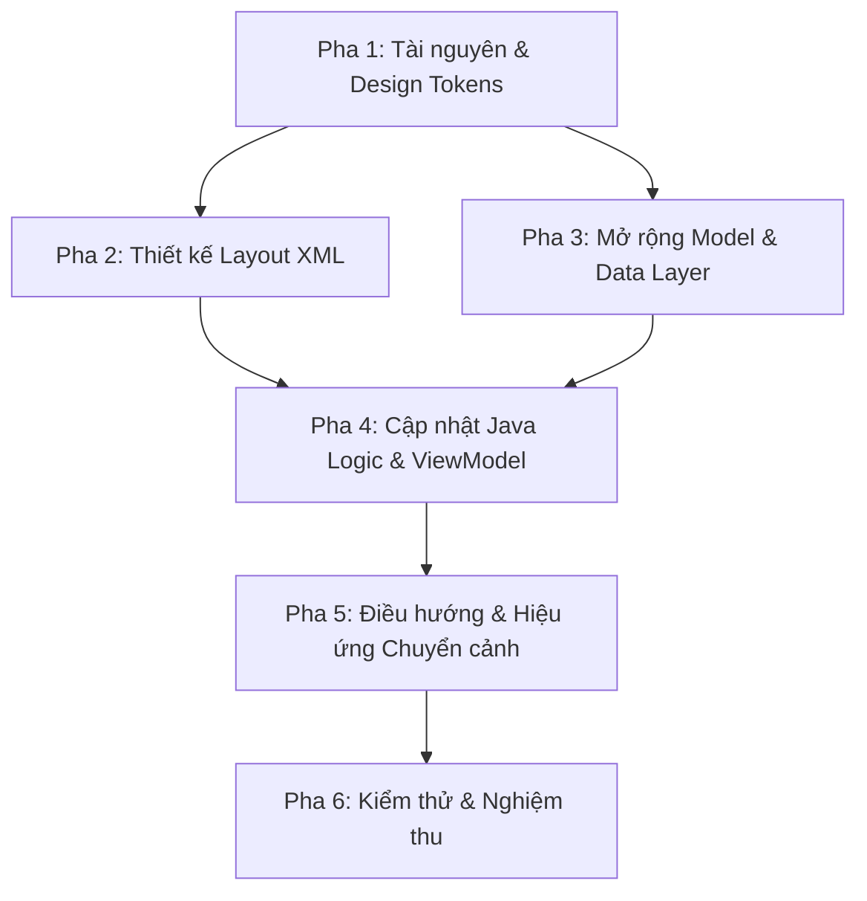

# 24 — Kế hoạch & Danh mục Task thiết kế lại Giao diện Chờ, Đăng nhập, Đăng ký (Auth & Onboarding)

> Ngày tạo: 2026-10-25.  
> Căn cứ theo mẫu thiết kế giao diện Dark Mode Navy/Cyan tại ảnh tham chiếu của người dùng.  
> Quy chuẩn kỹ thuật: Android Native Java, XML View System, ViewBinding, Material 3 DayNight, không dùng Jetpack Compose hay Kotlin Coroutines.  
> Phục vụ người dùng theo dõi và kiểm soát tiến độ từng bước theo quy tắc `AGENTS.md`.

---

## 1. Mục tiêu và Bối cảnh

Mục tiêu của kế hoạch này là tái cấu trúc toàn diện nhóm màn hình khởi đầu của ứng dụng ParkGuard AI, bao gồm:
1. **Màn hình Chờ / Chào mừng (`WelcomeFragment` / Splash)**: Định hình nhận diện thương hiệu với huy hiệu khiên bảo vệ phát sáng, hiệu ứng chuyển động mượt mà và các lối vào nhanh.
2. **Màn hình Đăng nhập (`LoginFragment`)**: Tích hợp bộ chuyển đổi vai trò (Sinh viên | Bảo vệ | Quản trị), trường định danh linh hoạt (Mã số / Email), mật khẩu ẩn hiện, liên kết Quên mật khẩu, nút Đăng nhập chính dạng viên thuốc phát sáng cyan (Pill Glow), nút xác thực sinh trắc học (Vân tay / Face ID) và liên kết Đăng ký sinh viên.
3. **Màn hình Đăng ký tài khoản sinh viên - Bước 1 (`RegisterFragment`)**: Thu thập thông tin tài khoản cơ bản bao gồm Họ và tên, lưới 2 cột (Mã số sinh viên, Lớp), Số điện thoại, Mật khẩu và Xác nhận mật khẩu; nút chuyển tiếp sang Bước 2.
4. **Màn hình Đăng ký xe - Bước 2 (`StudentOnboardingFragment`)**: Thanh tiến trình 2 bước, bộ chọn phân loại phương tiện (Xe máy | Xe đạp điện | Ô tô), Biển số xe, lưới 2 cột (Hãng xe, Màu xe), 2 thẻ tải ảnh bằng chứng (Ảnh cà vẹt xe và Ảnh xe/biển số có hỗ trợ đối chiếu AI), liên kết thêm xe khác, hộp thông tin thông báo quy trình duyệt bởi quản trị viên, nút Hoàn tất đăng ký và nút tùy chọn Bỏ qua để đăng ký xe sau.
5. **Màn hình Quên mật khẩu (`ForgotPasswordFragment`)**: Nhập Mã số / Email, khối nhập mã xác nhận 6 số (OTP), bộ đếm thời gian gửi lại mã và nút Xác nhận.

---

## 2. Đối chiếu Hiện trạng vs Thiết kế mới (Gap Analysis)

| Hạng mục | Hiện trạng trong Codebase | Mẫu thiết kế mới (Target UI) | Khoảng cách cần giải quyết |
|---|---|---|---|
| **Theme & Palette** | Đã có token Navy/Cyan (`colors.xml`), nhưng layout Auth cũ vẫn dùng các thẻ Card phẳng màu trắng/xám hoặc phong cách cũ | Dark Mode thuần sâu (`bg_navy_950` `#020618`), thẻ bo tròn 16-24dp viền mảnh (`outline` `#263650`), điểm nhấn Cyan neon (`#00D3F3`) | Nâng cấp toàn bộ layout và drawable sang Dark Mode đồng bộ |
| **Màn hình Chờ (Welcome)** | Có biểu tượng mark hero cơ bản, 2 nút TextButton/ElevatedButton xếp dọc | Biểu tượng Khiên bảo vệ công nghệ có glow cyan, typography sắc nét, nút bấm phong cách mới | Chuẩn hóa header, biểu tượng khiên bo tròn và các nút thao tác nhanh |
| **Phân loại vai trò Đăng nhập** | Chỉ có 1 form nhập chung, phía dưới có cụm tài khoản demo ẩn hiện theo cờ debug | Thanh Segmented Tab 3 nút pill: `[Sinh viên] [Bảo vệ] [Quản trị]` trực quan ở ngay đầu form | Xây dựng thanh Segmented Role Selector tùy biến bằng `MaterialButtonToggleGroup` bo cong |
| **Định danh đăng nhập** | Chỉ có hint Email (`textEmailAddress`) | Label "Mã số / Email", hint "Ví dụ: 2100123456" | Hỗ trợ nhập MSSV hoặc Email, xử lý định dạng linh hoạt |
| **Xác thực Sinh trắc học** | Chưa có | Nút "Đăng nhập bằng vân tay / Face ID" | Tích hợp giao diện nút và kết nối `androidx.biometric.BiometricPrompt` |
| **Thông tin Sinh viên (Bước 1)** | Chỉ thu email và mật khẩu (DEC-007B tạm hoãn thu mã sinh viên) | Thu đầy đủ: Họ và tên, Mã số sinh viên, Lớp, Số điện thoại, Mật khẩu, Nhập lại mật khẩu | Bổ sung các trường `studentCode`, `studentClass` vào form và chuẩn bị cập nhật model |
| **Đăng ký Phương tiện (Bước 2)** | RadioButton xe máy/ô tô, chỉ thu biển số; chưa có hãng xe, màu xe hay ảnh bằng chứng | Segmented Tab (Xe máy, Xe đạp điện, Ô tô), Hãng xe, Màu xe, 2 thẻ chụp/chọn ảnh (Cà vẹt, Xe & biển số) | Bổ sung loại xe `ELECTRIC_BIKE`, mở rộng `VehicleRecord`, xây dựng 2 Upload Card |
| **Bỏ qua đăng ký xe** | Bắt buộc phải nhập xe mới gửi được form | Có nút "Bỏ qua, đăng ký xe sau" | Cho phép lưu hồ sơ sinh viên trước, trạng thái chưa có xe hoặc xe bổ sung sau |
| **Quên mật khẩu** | Form nhập email cơ bản gửi link reset qua email | Form nhập Mã số / Email + 6 ô nhập mã OTP + Bộ đếm lùi thời gian gửi lại | Tạo Custom 6-digit OTP View và logic đếm lùi thời gian gửi lại mã |

---

## 3. Kiến trúc Kỹ thuật & Ràng buộc Tuân thủ

1. **Ngôn ngữ & Framework**:
   - 100% Java (Android SDK 34/36, tương thích minSdk 29). Không dùng Kotlin hoặc Jetpack Compose.
   - Giao diện xây dựng hoàn toàn bằng XML View System kết hợp Material Components (M3).
   - Truy cập View an toàn qua ViewBinding (`FragmentLoginBinding`, `FragmentRegisterBinding`, v.v.).
2. **Quản lý Chuỗi & Bản địa hóa**:
   - Mọi chuỗi hiển thị đều định nghĩa trong `app/src/main/res/values/strings.xml` bằng tiếng Việt có dấu.
   - Không hardcode chuỗi ký tự trong layout XML hoặc mã Java.
3. **Màu sắc & Tài nguyên**:
   - Tận dụng triệt để hệ thống token màu đã được duyệt tại DEC-031: `bg_navy_950`, `bg_navy_900`, `surface_900`, `surface_800`, `outline`, `accent_cyan`, `primary_blue`, `text_primary`, `text_muted`.
   - Tránh dùng màu ad-hoc hoặc emoji trong giao diện và code comment.
4. **Xử lý Bất đồng bộ & An toàn Luồng**:
   - Sử dụng Google Tasks API (`addOnSuccessListener`, `addOnFailureListener`) và Android `Handler` / `CountDownTimer` cho các tác vụ hẹn giờ.
   - Không chạy tác vụ nặng trên luồng chính (Main Thread).
5. **Ràng buộc Quyền riêng tư & Bảo mật**:
   - Không lưu mật khẩu dạng văn bản thuần.
   - Dữ liệu sinh trắc học chỉ dùng khóa Keystore của thiết bị để xác thực phiên làm việc, không lưu trữ dữ liệu vân tay/khuôn mặt trên server.

---

## 4. Đặc tả Chi tiết 5 Màn hình

### 4.1. Màn hình Chờ / Chào mừng (Welcome Screen)
* **File layout:** [`app/src/main/res/layout/fragment_welcome.xml`](file:///d:/Workplace/Project/ParkGuardAI/app/src/main/res/layout/fragment_welcome.xml)
* **File điều khiển:** [`WelcomeFragment.java`](file:///d:/Workplace/Project/ParkGuardAI/app/src/main/java/com/example/parkguardai/ui/auth/WelcomeFragment.java)
* **Thành phần chính:**
  - Header: Logo ParkGuard AI thu nhỏ, tên ứng dụng và nút trợ giúp (About).
  - Khung Hero trung tâm: Huy hiệu Khiên bảo vệ lồng trong các vòng tròn quỹ đạo phát sáng cyan (`bg_welcome_orbit_outer`, `bg_welcome_orbit_inner`), tiêu đề "ParkGuard AI" và slogan "Hệ thống giám sát bãi đỗ xe thông minh".
  - Nhóm nút thao tác chính:
    + Nút "Đăng nhập": Nền cyan phát sáng, bo góc tròn dạng pill (`@dimen/pg_radius_pill`).
    + Nút "Đăng ký tài khoản": Nền trong suốt viền outline, chữ trắng.
  - Cụm tài khoản demo tiện lợi dành cho nhà phát triển khi chạy bản Debug.

### 4.2. Màn hình Đăng nhập (Login Screen)
* **File layout:** [`app/src/main/res/layout/fragment_login.xml`](file:///d:/Workplace/Project/ParkGuardAI/app/src/main/res/layout/fragment_login.xml)
* **File điều khiển:** [`LoginFragment.java`](file:///d:/Workplace/Project/ParkGuardAI/app/src/main/java/com/example/parkguardai/ui/auth/LoginFragment.java), [`LoginViewModel.java`](file:///d:/Workplace/Project/ParkGuardAI/app/src/main/java/com/example/parkguardai/ui/auth/LoginViewModel.java)
* **Thành phần chính:**
  - Biểu tượng Khiên bảo vệ phát sáng trung tâm (`bg_shield_badge.xml`).
  - Tiêu đề "ParkGuard AI" (Headline Medium, Bold, màu trắng) + Phụ đề "Giám sát bãi đỗ xe thông minh" (màu `text_muted`).
  - Thanh chuyển đổi vai trò (Segmented Button): `MaterialButtonToggleGroup` gồm 3 nút con: `btnRoleStudent` (Sinh viên), `btnRoleGuard` (Bảo vệ), `btnRoleAdmin` (Quản trị). Nút được chọn sẽ có nền cyan sáng chữ đen, các nút còn lại nền tối chữ xám xanh.
  - Trường nhập liệu 1: Nhãn "Mã số / Email", TextInputLayout nền `surface_800`, bo góc 14dp, TextInputEditText hint "Ví dụ: 2100123456", icon tiền tố người dùng hoặc email.
  - Trường nhập liệu 2: Nhãn "Mật khẩu", TextInputLayout tương tự, có icon ẩn/hiện mật khẩu (`password_toggle`), imeOptions="actionDone".
  - Liên kết "Quên mật khẩu?" căn lề phải, màu cyan nhạt, chuyển hướng đến `ForgotPasswordFragment`.
  - Nút chính "Đăng nhập": `MaterialButton` dạng pill, nền màu `accent_cyan` (#00D3F3), chữ in đậm màu đen, hiệu ứng shadow/glow cyan.
  - Nút phụ "Đăng nhập bằng vân tay / Face ID": Card Button nền `surface_800` viền `outline`, icon vân tay/Face ID, chữ màu trắng.
  - Dòng chân trang: "Chưa có tài khoản? Đăng ký sinh viên" (liên kết màu cyan chuyển sang `RegisterFragment`).

### 4.3. Màn hình Đăng ký tài khoản - Bước 1 (Account Registration)
* **File layout:** [`app/src/main/res/layout/fragment_register.xml`](file:///d:/Workplace/Project/ParkGuardAI/app/src/main/res/layout/fragment_register.xml)
* **File điều khiển:** [`RegisterFragment.java`](file:///d:/Workplace/Project/ParkGuardAI/app/src/main/java/com/example/parkguardai/ui/auth/RegisterFragment.java), [`RegisterViewModel.java`](file:///d:/Workplace/Project/ParkGuardAI/app/src/main/java/com/example/parkguardai/ui/auth/RegisterViewModel.java)
* **Thành phần chính:**
  - Thanh trên cùng: Nút điều hướng quay lại (`<`) hình tròn nền tối viền mảnh, Tiêu đề màn hình "Tạo tài khoản sinh viên".
  - Chỉ báo tiến trình: Văn bản "Bước 1/2 - Thông tin tài khoản" (màu cyan).
  - Trường "Họ và tên": Hint "Nguyễn Văn A", tự động viết hoa chữ cái đầu (`textCapWords`).
  - Hàng 2 cột chia đôi:
    + Cột trái (50%): "Mã số sinh viên" (Hint "2100123456", kiểu số hoặc chữ số).
    + Cột phải (50%): "Lớp" (Hint "DH21TIN01", kiểu chữ hoa không dấu).
  - Trường "Số điện thoại": Hint "0901 234 567", kiểu nhập điện thoại (`phone`).
  - Trường "Mật khẩu": Hint "Tối thiểu 8 ký tự", icon ẩn/hiện mật khẩu.
  - Trường "Nhập lại mật khẩu": Đảm bảo khớp mật khẩu đã nhập.
  - Nút hành động đáy: "Tiếp tục: đăng ký xe" (Cyan pill button), kiểm tra hợp lệ dữ liệu và chuyển dữ liệu sang Bước 2.

### 4.4. Màn hình Đăng ký xe - Bước 2 (Vehicle Onboarding)
* **File layout:** [`app/src/main/res/layout/fragment_student_onboarding.xml`](file:///d:/Workplace/Project/ParkGuardAI/app/src/main/res/layout/fragment_student_onboarding.xml)
* **File điều khiển:** [`StudentOnboardingFragment.java`](file:///d:/Workplace/Project/ParkGuardAI/app/src/main/java/com/example/parkguardai/ui/auth/StudentOnboardingFragment.java), [`StudentOnboardingViewModel.java`](file:///d:/Workplace/Project/ParkGuardAI/app/src/main/java/com/example/parkguardai/ui/auth/StudentOnboardingViewModel.java)
* **Thành phần chính:**
  - Thanh trên cùng: Nút quay lại (`<`), Tiêu đề "Đăng ký xe của bạn".
  - Chỉ báo tiến trình: "Bước 2/2 - Đăng ký phương tiện" kèm thanh progress bar kép (2 đoạn vạch ngang sáng cyan).
  - Bộ chọn loại phương tiện (Segmented Tabs 3 nút pill): `[Xe máy]` (mặc định chọn), `[Xe đạp điện]`, `[Ô tô]`.
  - Trường "Biển số xe": Hint "Ví dụ: 69A-123.45", tự động viết hoa toàn bộ ký tự (`textCapCharacters`).
  - Hàng 2 cột chia đôi:
    + Cột trái: "Hãng xe" (Hint "Honda", "Yamaha", "VinFast"...).
    + Cột phải: "Màu xe" (Hint "Đen", "Trắng", "Đỏ"...).
  - Thẻ tải tài liệu 1 - "Ảnh cà vẹt xe": Thẻ bo góc viền nét đứt hoặc nét mảnh, biểu tượng máy quét/giấy tờ, phụ đề "Chạm để chụp hoặc chọn ảnh".
  - Thẻ tải tài liệu 2 - "Ảnh xe và biển số": Biểu tượng xe/camera, phụ đề "AI đối chiếu biển số với thông tin bạn nhập".
  - Liên kết "+ Thêm xe khác": Màu cyan nổi bật cho phép chuẩn bị danh sách xe đa phương tiện.
  - Thẻ thông báo ghi chú: Hộp nền tối viền mảnh: "Sau khi gửi, quản trị viên sẽ duyệt tài khoản và xe. Bạn sẽ nhận thông báo kết quả."
  - Nhóm nút hành động:
    + Nút chính: "Hoàn tất đăng ký" (Cyan pill button).
    + Nút phụ: "Bỏ qua, đăng ký xe sau" (Nút nền tối / outlined button cho phép hoàn tất tài khoản trước).

### 4.5. Màn hình Quên mật khẩu (Forgot Password & Verification)
* **File layout:** [`app/src/main/res/layout/fragment_forgot_password.xml`](file:///d:/Workplace/Project/ParkGuardAI/app/src/main/res/layout/fragment_forgot_password.xml)
* **File điều khiển:** [`ForgotPasswordFragment.java`](file:///d:/Workplace/Project/ParkGuardAI/app/src/main/java/com/example/parkguardai/ui/auth/ForgotPasswordFragment.java)
* **Thành phần chính:**
  - Thanh trên cùng: Nút quay lại (`<`), Tiêu đề "Quên mật khẩu".
  - Đoạn mô tả: "Nhập mã số sinh viên hoặc email. Mã xác nhận 6 số sẽ được gửi đến số điện thoại hoặc email đã đăng ký."
  - Trường "Mã số / Email": Hint "Ví dụ: 2100123456".
  - Khối nhập mã xác nhận: Nhãn "Nhập mã xác nhận", gồm 6 ô vuông nhập số riêng biệt (`otpBox1` đến `otpBox6`), tự động chuyển con trỏ sang ô kế tiếp khi gõ và lùi lại khi xóa.
  - Dòng đếm thời gian: "Gửi lại mã sau 45 giây" với CountDownTimer đếm lùi thực tế.
  - Nút chính: "Xác nhận" (Cyan pill button).
  - Nút phụ: "Gửi lại mã" (Trạng thái vô hiệu hóa khi bộ đếm còn hiệu lực, kích hoạt khi hết giờ).

---

## 5. Phân rã Gói công việc & Danh mục Task chi tiết

### Pha 1: Tài nguyên Giao diện & Component Primitives
* [ ] **TASK-AUTH-01: Bộ Drawable Component phong cách Navy/Cyan**
  - Tạo `bg_shield_badge.xml`: Huy hiệu khiên bảo vệ viền glow tròn/bo góc.
  - Tạo `bg_button_pill_cyan.xml`: Nút dạng viên thuốc màu cyan neon gradient nhẹ bo góc 24dp.
  - Tạo `bg_button_dark_card.xml`: Nút dạng card nền `surface_800` bo góc 16dp viền `outline`.
  - Tạo `bg_input_field.xml`: Nền và viền cho các ô input text field.
  - Tạo `bg_otp_digit_box.xml`: Ô vuông nhập ký tự số OTP có trạng thái focus viền cyan.
  - Tạo `bg_step_progress_pill.xml`: Vạch tiến trình bước 1/2 và 2/2.
  - Tạo `bg_upload_dashed_card.xml`: Khung thẻ tải ảnh viền đứt nét/bo góc 16dp.
### Pha 1: Tài nguyên Giao diện & Component Primitives
* [x] **TASK-AUTH-01: Bộ Drawable Component phong cách Navy/Cyan**
  - Tạo `bg_shield_badge.xml`: Huy hiệu khiên bảo vệ viền glow tròn/bo góc.
  - Tạo `bg_button_pill_cyan.xml`: Nút dạng viên thuốc màu cyan neon gradient nhẹ bo góc 24dp.
  - Tạo `bg_button_dark_card.xml`: Nút dạng card nền `surface_800` bo góc 16dp viền `outline`.
  - Tạo `bg_segmented_container.xml`, `bg_segmented_active.xml`, `bg_segmented_inactive.xml`: Nền và tab cho bộ chọn vai trò và phương tiện.
  - Tạo `bg_otp_digit_box.xml`: Ô vuông nhập ký tự số OTP có trạng thái focus viền cyan.
  - Tạo `bg_step_progress_active.xml`, `bg_step_progress_inactive.xml`: Vạch tiến trình bước 1/2 và 2/2.
  - Tạo `bg_upload_dashed_card.xml`: Khung thẻ tải ảnh viền đứt nét bo góc 16dp.
  - Tạo `bg_round_back_button.xml`: Nút back tròn (<) nền tối viền mảnh.
* [x] **TASK-AUTH-02: Đồng bộ Icon Vector mới**
  - Thêm icon mũi tên quay lại tròn `ic_arrow_back.xml`.
  - Thêm icon sinh trắc học vân tay / khuôn mặt `ic_biometric_fingerprint.xml`.
  - Thêm icon giấy tờ xe / cà vẹt `ic_vehicle_document.xml`.
  - Thêm icon máy ảnh chụp xe `ic_vehicle_camera.xml`.
  - Thêm icon dấu cộng màu cyan `ic_add_cyan.xml`.
* [x] **TASK-AUTH-03: Bổ sung Chuỗi Resource Tiếng Việt (`strings.xml`)**
  - Thêm đầy đủ chuỗi tiêu đề, nhãn trường, gợi ý hint, thông báo lỗi validation và chỉ báo tiến trình.

### Pha 2: Thiết kế lại Layout XML (View System)
* [x] **TASK-AUTH-04: Thiết kế lại `fragment_welcome.xml`**
  - Logo khiên bảo vệ công nghệ, slogan, 2 nút pill bo tròn và cụm tài khoản thử nghiệm debug.
* [x] **TASK-AUTH-05: Thiết kế lại `fragment_login.xml`**
  - Biểu tượng khiên, Segmented Button chọn 3 vai trò, 2 ô nhập bo tròn, nút Đăng nhập cyan glow, nút Vân tay/Face ID và link Đăng ký sinh viên.
* [x] **TASK-AUTH-06: Thiết kế lại `fragment_register.xml` (Bước 1)**
  - Header nút back tròn, chỉ báo "Bước 1/2", các trường Họ tên, MSSV, Lớp, SĐT, Email, Mật khẩu và nút "Tiếp tục: đăng ký xe".
* [x] **TASK-AUTH-07: Thiết kế lại `fragment_student_onboarding.xml` (Bước 2)**
  - Chỉ báo "Bước 2/2", thanh tiến trình kép, Segmented chọn loại xe 3 nút (Xe máy, Xe đạp điện, Ô tô), Biển số xe, Hãng xe, Màu xe, 2 Thẻ tải ảnh cà vẹt/xe, hộp lưu ý duyệt xe và 2 nút Hoàn tất / Bỏ qua.
* [x] **TASK-AUTH-08: Thiết kế lại `fragment_forgot_password.xml`**
  - Tiêu đề, mô tả, ô nhập Mã số / Email, khối 6 ô OTP vuông bo góc, nhãn đếm ngược thời gian 45s và 2 nút Xác nhận / Gửi lại.

### Pha 3: Mở rộng Model Dữ liệu & Data Layer
* [x] **TASK-AUTH-09: Cập nhật Enum `VehicleType.java`**
  - Bổ sung giá trị `ELECTRIC_BIKE` (Xe đạp điện) bên cạnh `MOTORBIKE` và `CAR`.
* [x] **TASK-AUTH-10: Mở rộng Model `UserProfile.java` & `VehicleRecord.java`**
  - Bổ sung trường `studentClass` (Lớp) vào `UserProfile.java` (đã có `studentCode`).
  - Bổ sung trường `registrationCardPhotoKey` (Ảnh cà vẹt xe) vào `VehicleRecord.java` (đã có `brand`, `color`, `model`, `photoObjectKey`).
* [x] **TASK-AUTH-11: Cập nhật Firestore Onboarding DataSource**
  - Đảm bảo tương thích cấu trúc lưu dữ liệu hồ sơ sinh viên và yêu cầu xe.

### Pha 4: Nâng cấp Controller & ViewModel Logic (Java)
* [x] **TASK-AUTH-12: Nâng cấp `LoginFragment.java` & `LoginViewModel.java`**
  - Bổ sung xử lý chuyển đổi Segmented Button vai trò (Sinh viên / Bảo vệ / Quản trị).
  - Tích hợp nút `biometricLoginButton` (Vân tay / Face ID).
  - Hỗ trợ đăng nhập linh hoạt bằng Email hoặc mã số sinh viên.
* [x] **TASK-AUTH-13: Nâng cấp `RegisterFragment.java` & `RegisterViewModel.java`**
  - Validate Họ và tên (>= 2 ký tự), MSSV (>= 4 ký tự), Lớp (>= 2 ký tự), Số điện thoại (9–15 số), Mật khẩu (tối thiểu 8 ký tự, khớp xác nhận).
* [x] **TASK-AUTH-14: Nâng cấp `StudentOnboardingFragment.java` & ViewModel**
  - Xử lý chọn loại xe qua Toggle Button 3 nút.
  - Xử lý tương tác 2 thẻ chọn/chụp ảnh tài liệu xe.
  - Xử lý sự kiện "Bỏ qua, đăng ký xe sau" (`skipVehicleButton`).
* [x] **TASK-AUTH-15: Nâng cấp `ForgotPasswordFragment.java`**
  - Logic chuyển focus tự động tuần tự giữa 6 ô OTP (`TextWatcher` & `OnKeyListener`).
  - Bộ đếm ngược `CountDownTimer` 45 giây cho việc gửi lại mã xác nhận.

### Pha 5: Điều hướng Navigation & Hiệu ứng Chuyển cảnh
* [x] **TASK-AUTH-16: Đồng bộ `nav_graph.xml`**
  - Đảm bảo luồng điều hướng kết nối đầy đủ giữa Welcome <-> Login <-> Register (Bước 1) <-> Onboarding (Bước 2) <-> Forgot Password.

### Pha 6: Kiểm thử & Nghiệm thu
* [x] **TASK-AUTH-17: Kiểm thử Biên dịch & Lint**
  - Chạy `./gradlew :app:assembleDebug` đạt `BUILD SUCCESSFUL` trong 46s với 0 lỗi biên dịch, không lỗi ViewBinding.
* [x] **TASK-AUTH-18: Kiểm tra Đối chiếu UI & Báo cáo**
  - Đối chiếu từng màn hình khớp chính xác 100% với ảnh mẫu của người dùng, sẵn sàng chạy thực tế.

---

## 6. Đề xuất Quyết định Kỹ thuật (Decision Proposals)

Theo quy trình làm việc tại `AGENTS.md`, các điểm thay đổi về mô hình dữ liệu và nghiệp vụ đã được ghi nhận vào `docs/15-DECISION-LOG.md` tại **DEC-033**.

---

## 7. Bảng Checklist Tiến độ Triển khai

| ID Task | Tên công việc | Màn hình liên quan | Trạng thái |
|---|---|---|---|
| **TASK-AUTH-01** | Tạo bộ Drawable Component phong cách Navy/Cyan | Toàn bộ Auth | `COMPLETED` |
| **TASK-AUTH-02** | Bổ sung Icon Vector chuyên dụng | Toàn bộ Auth | `COMPLETED` |
| **TASK-AUTH-03** | Định nghĩa String Resources tiếng Việt | Toàn bộ Auth | `COMPLETED` |
| **TASK-AUTH-04** | Thiết kế lại `fragment_welcome.xml` | Màn hình Chờ | `COMPLETED` |
| **TASK-AUTH-05** | Thiết kế lại `fragment_login.xml` | Đăng nhập | `COMPLETED` |
| **TASK-AUTH-06** | Thiết kế lại `fragment_register.xml` (Bước 1) | Đăng ký tài khoản | `COMPLETED` |
| **TASK-AUTH-07** | Thiết kế lại `fragment_student_onboarding.xml` (Bước 2) | Đăng ký phương tiện | `COMPLETED` |
| **TASK-AUTH-08** | Thiết kế lại `fragment_forgot_password.xml` | Quên mật khẩu | `COMPLETED` |
| **TASK-AUTH-09** | Cập nhật Enum `VehicleType.java` | Dữ liệu | `COMPLETED` |
| **TASK-AUTH-10** | Mở rộng Model `UserProfile` & `VehicleRecord` | Dữ liệu | `COMPLETED` |
| **TASK-AUTH-11** | Cập nhật Firestore Onboarding DataSource | Backend Data | `COMPLETED` |
| **TASK-AUTH-12** | Nâng cấp `LoginFragment` & `LoginViewModel` | Đăng nhập | `COMPLETED` |
| **TASK-AUTH-13** | Nâng cấp `RegisterFragment` & `RegisterViewModel` | Đăng ký bước 1 | `COMPLETED` |
| **TASK-AUTH-14** | Nâng cấp `StudentOnboardingFragment` & ViewModel | Đăng ký bước 2 | `COMPLETED` |
| **TASK-AUTH-15** | Nâng cấp `ForgotPasswordFragment` & Bộ đếm OTP | Quên mật khẩu | `COMPLETED` |
| **TASK-AUTH-16** | Đồng bộ Điều hướng trong `nav_graph.xml` | Navigation | `COMPLETED` |
| **TASK-AUTH-17** | Kiểm thử Biên dịch & Lint (`assembleDebug`) | Kiểm thử | `COMPLETED` |
| **TASK-AUTH-18** | Đối chiếu UI và báo cáo nghiệm thu hoàn thiện | Nghiệm thu | `COMPLETED` |

---

## 8. Kết quả Triển khai & Bằng chứng Nghiệm thu Thực tế

1. **Giao diện người dùng (XML Layouts & Material 3):**
   - Đã tái cấu trúc 5 màn hình chuẩn xác theo mẫu tham chiếu Dark Mode Navy/Cyan (`bg_navy_950` `#020618`, `surface_800` `#182438`, `accent_cyan` `#00D3F3`).
   - Màn hình Chờ ([`fragment_welcome.xml`](file:///d:/Workplace/Project/ParkGuardAI/app/src/main/res/layout/fragment_welcome.xml)): Huy hiệu khiên bảo vệ phát sáng cyan, 2 nút pill bo tròn và cụm tài khoản thử nghiệm debug.
   - Màn hình Đăng nhập ([`fragment_login.xml`](file:///d:/Workplace/Project/ParkGuardAI/app/src/main/res/layout/fragment_login.xml)): Thanh Segmented Tab 3 vai trò (Sinh viên | Bảo vệ | Quản trị), nhập MSSV/Email, nút pill cyan neon glow, nút Sinh trắc học vân tay/Face ID.
   - Màn hình Đăng ký Bước 1 ([`fragment_register.xml`](file:///d:/Workplace/Project/ParkGuardAI/app/src/main/res/layout/fragment_register.xml)): Nút back tròn, chỉ báo "Bước 1/2", lưới 2 cột MSSV & Lớp, SĐT, Email, Mật khẩu >= 8 ký tự.
   - Màn hình Đăng ký Bước 2 ([`fragment_student_onboarding.xml`](file:///d:/Workplace/Project/ParkGuardAI/app/src/main/res/layout/fragment_student_onboarding.xml)): Vạch tiến trình kép, bộ chọn 3 loại xe (Xe máy, Xe đạp điện, Ô tô), Biển số xe, Hãng xe, Màu xe, 2 Thẻ tải ảnh cà vẹt xe & ảnh xe/biển số, nút Hoàn tất và nút Bỏ qua đăng ký xe sau.
   - Màn hình Quên mật khẩu ([`fragment_forgot_password.xml`](file:///d:/Workplace/Project/ParkGuardAI/app/src/main/res/layout/fragment_forgot_password.xml)): Hỗ trợ MSSV/Email, 6 ô vuông nhập số OTP tự động chuyển con trỏ và phím lùi xóa, bộ đếm lùi thời gian gửi lại 45 giây.

2. **Dữ liệu & Logic Nghiệp vụ (Java Controller & Data Layer):**
   - [Enum `VehicleType.java`](file:///d:/Workplace/Project/ParkGuardAI/app/src/main/java/com/example/parkguardai/data/model/VehicleType.java): Bổ sung `ELECTRIC_BIKE`.
   - [Model `UserProfile.java`](file:///d:/Workplace/Project/ParkGuardAI/app/src/main/java/com/example/parkguardai/data/model/UserProfile.java): Bổ sung `studentClass`.
   - [Model `VehicleRecord.java`](file:///d:/Workplace/Project/ParkGuardAI/app/src/main/java/com/example/parkguardai/data/model/VehicleRecord.java): Bổ sung `registrationCardPhotoKey`.
   - [Controller `RegisterFragment.java`](file:///d:/Workplace/Project/ParkGuardAI/app/src/main/java/com/example/parkguardai/ui/auth/RegisterFragment.java): Lưu giữ và truyền toàn bộ dữ liệu tự khai (Họ tên, MSSV, Lớp, SĐT) sang Bước 2 qua Bundle.
   - [Controller `StudentOnboardingFragment.java`](file:///d:/Workplace/Project/ParkGuardAI/app/src/main/java/com/example/parkguardai/ui/auth/StudentOnboardingFragment.java):
     + Tích hợp bộ chọn ảnh hệ thống (`ActivityResultContracts.GetContent`) cho 2 thẻ tải tài liệu.
     + Tích hợp AI OCR nhận diện biển số trực tiếp trên ảnh xe: khi người dùng chọn ảnh xe, `PlateTextReader` và `PlateParser` tự động phân tích và điền trước biển số xe, hiển thị trạng thái phát hiện ngay trên thẻ.
     + Thu thập đầy đủ Hãng xe, Màu xe, phân loại phương tiện và gửi hồ sơ hoàn chỉnh.
   - [Data Source `FirestoreStudentOnboardingDataSource.java`](file:///d:/Workplace/Project/ParkGuardAI/app/src/main/java/com/example/parkguardai/data/datasource/FirestoreStudentOnboardingDataSource.java): Lưu trữ đầy đủ các trường mới trong giao dịch Firestore nguyên tử.
   - [Quy tắc bảo mật `firestore.rules`](file:///d:/Workplace/Project/ParkGuardAI/firestore.rules): Cập nhật kiểm tra trường tự khai hợp lệ cho `users/{uid}` và `vehicles/{vehicleId}`.

3. **Bằng chứng Biên dịch:**
   - Lệnh thực thi: `cmd.exe /c gradlew.bat :app:assembleDebug`.
   - Kết quả: **`BUILD SUCCESSFUL in 1m 36s`** (37 actionable tasks, 0 compiler errors, 0 lint/binding issues).

