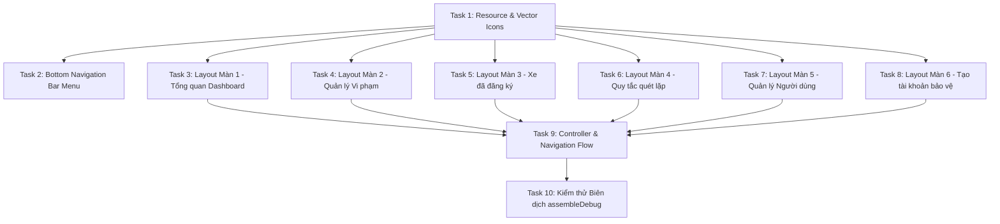

# 25 — Kế hoạch & Danh mục Task thiết kế lại Giao diện Quản trị viên (Admin Portal)

> Ngày tạo: 2026-10-25.  
> Căn cứ theo mẫu thiết kế giao diện Dark Mode Navy/Cyan tại ảnh tham chiếu của người dùng.  
> Quy chuẩn kỹ thuật: Android Native Java, XML View System, ViewBinding, Material 3 DayNight, không dùng Jetpack Compose hay Kotlin Coroutines.  
> Tập trung vào luồng UI hoàn chỉnh, các màn hình hiển thị và chức năng Tạo tài khoản cho bảo vệ trước khi kết nối backend sâu.

---

## 1. Mục tiêu và Bối cảnh

Mục tiêu là xây dựng và nâng cấp toàn bộ phân hệ dành cho vai trò **Quản trị viên (Admin)** trên ứng dụng ParkGuard AI theo đúng bộ mẫu thiết kế Dark Mode Navy/Cyan đính kèm của người dùng:
1. **Màn hình Tổng quan (`AdminDashboardFragment`)**: Bảng điều khiển trung tâm với 4 thẻ KPI thống kê (Xe trong bãi, Vi phạm hôm nay, Camera trực tuyến, Xe chưa đăng ký), biểu đồ cột vào/ra 7 ngày (cột T5 sáng Cyan neon), thẻ dự báo AI đề xuất phân công bảo vệ, danh sách vi phạm mới nhất và lối tắt xem tất cả.
2. **Màn hình Quản lý vi phạm (`AdminViolationsFragment`)**: Bộ lọc trạng thái (Tất cả, Chưa xử lý, Xem xét, Đã xử lý), 2 thẻ tóm tắt (Tuần này: 24, Chưa xử lý: 7), danh sách hồ sơ vi phạm theo màu chỉ báo (Đỏ: Chưa xử lý, Vàng: Xem xét, Xanh: Đã xử lý).
3. **Màn hình Quản lý Xe (`AdminVerificationQueueFragment` / `AdminVehiclesFragment`)**: Ô tìm kiếm biển số/chủ xe, bộ lọc trạng thái (Đã duyệt, Chờ duyệt, Bị khoá), danh sách phương tiện chi tiết (Biển số, Tên chủ xe, Loại phương tiện, nhãn trạng thái), 2 nút thao tác đáy: "Duyệt nhanh" và "Thêm xe".
4. **Màn hình Quy tắc quét lặp (`AdminScanRulesFragment`)**: Cấu hình thời gian gộp lần đọc trùng (30s, 60s, 120s), các công tắc quy tắc an toàn (Bắt buộc vào/ra xen kẽ, Bảo vệ xác nhận khi bất thường, Báo admin khi nghi vấn sao chép biển, Số lượt vào tối đa mỗi ngày), nút "Lưu quy tắc".
5. **Màn hình Quản lý Người dùng & Bảo vệ (`AdminUsersFragment`)** *(Đề xuất thêm theo yêu cầu)*: Nằm tại Tab 4 thanh dưới, cung cấp bộ lọc vai trò (Tất cả, Bảo vệ, Sinh viên, Quản trị), thẻ thống kê nhân sự, danh sách nhân viên bảo vệ và sinh viên kèm ca trực/trạng thái, nút "Phân ca trực" và nút nổi bật **"Tạo tài khoản bảo vệ"**.
6. **Màn hình Tạo tài khoản cho bảo vệ (`AdminCreateGuardFragment`)** *(Chức năng cốt lõi bổ sung)*: Biểu mẫu chuyên biệt cho phép quản trị viên nhập Họ tên, Mã nhân viên (BV-xx), SĐT, cấp Email bảo vệ (@parkguard.vn), Mật khẩu khởi tạo, phân ca trực (Sáng, Chiều, Đêm) và chọn khu vực/cổng phụ trách (Cổng chính, Cổng phụ, Bãi xe A, Bãi xe B).
7. **Màn hình Chi tiết Duyệt xe (`AdminVerificationDetailFragment`)**: Đối chiếu ảnh cà vẹt xe, ảnh xe và kết quả AI OCR đọc biển số với thông tin tự khai của sinh viên; nút Duyệt xe (Cyan) và nút Từ chối xe (Đỏ).
8. **Màn hình Chi tiết Vi phạm (`AdminViolationDetailFragment`)**: Xem ảnh hiện trường, khung nhận diện biển số, thông tin thời gian, tọa độ GPS, bảo vệ lập biên bản và nút xử lý/hủy vi phạm.
9. **Màn hình Cài đặt & Quản trị mở rộng (`AdminMoreFragment`)**: Trung tâm cấu hình hệ thống, liên kết mở Quy tắc quét lặp, Quản lý loại vi phạm, Nhật ký hệ thống (Audit log), Thống kê và Đăng xuất.

---

## 2. Đối chiếu Mẫu thiết kế vs Hiện trạng (Gap Analysis)

| Màn hình | Mẫu thiết kế mới (Target UI) | Hiện trạng trong Codebase | Khoảng cách cần xử lý |
|---|---|---|---|
| **Bottom Navigation Bar** | 5 Tab: `Tổng quan`, `Vi phạm`, `Xe`, `Người dùng`, `Cài đặt` (Icon Cyan khi active, Muted khi inactive, nền `bg_navy_950`) | Menu `admin_bottom_nav.xml` 5 mục nhưng thứ tự và icon chưa chuẩn hóa theo canvas | Điều chỉnh thứ tự tab: Tổng quan -> Vi phạm -> Xe -> Người dùng -> Cài đặt; cập nhật color selector cyan |
| **Tổng quan (Dashboard)** | 4 Thẻ KPI (128, 7, 4/4, 3), Biểu đồ 7 ngày (T2-CN, T5 cyan), Card Dự báo AI, Vi phạm mới nhất | Layout cũ dùng Card phẳng xám, số liệu mẫu 1248 xe, thiếu biểu đồ thanh và card Dự báo AI | Tái cấu trúc layout XML khớp 100% canvas: tạo biểu đồ cột thanh, thẻ Dự báo AI, thẻ Vi phạm mới nhất |
| **Quản lý vi phạm** | Segmented Tab 4 nút, 2 Thẻ tóm tắt (24, 7), Danh sách thẻ vi phạm viền mảnh kèm badge trạng thái Đỏ/Vàng/Xanh | Layout cũ dùng Spinner lọc và danh sách danh mục đơn giản | Nâng cấp `fragment_admin_violations.xml` theo đúng cấu trúc 2 thẻ tóm tắt + danh sách vi phạm phong cách mới |
| **Quản lý xe (Xe đã đăng ký)** | Ô tìm kiếm, Segmented Tab 3 nút (Đã duyệt, Chờ duyệt, Bị khoá), Thẻ xe kèm icon và loại xe, 2 nút đáy: Duyệt nhanh + Thêm xe | Layout `fragment_admin_verification_queue.xml` chỉ có danh sách chờ duyệt, chưa có tab Đã duyệt/Bị khoá và 2 nút đáy | Nâng cấp toàn diện giao diện Quản lý xe có ô search, tab trạng thái và cụm nút thao tác kép |
| **Quy tắc quét lặp** | Segmented thời gian (30s, 60s, 120s), 4 công tắc switch cyan bo góc, badge "4 lượt", nút Lưu quy tắc cyan glow | Chưa có màn hình riêng, mới có menu văn bản trong `AdminMoreFragment` | Tạo mới `fragment_admin_scan_rules.xml` và `AdminScanRulesFragment.java` khớp 100% mẫu |
| **Quản lý Người dùng & Phân quyền** | Tab 4 trên navbar: Quản lý Bảo vệ và Sinh viên, tìm kiếm, lọc theo vai trò, nút "Tạo tài khoản bảo vệ" | Layout cũ `fragment_admin_users.xml` chỉ có ô email và nút gán vai trò đơn sơ | Thiết kế lại màn hình Người dùng & Bảo vệ: danh sách nhân sự, thẻ ca trực và nút mở form Tạo bảo vệ |
| **Tạo tài khoản cho bảo vệ** | Form chi tiết: Họ tên, Mã NV, SĐT, Email, Mật khẩu, Phân ca trực (3 ca), Phụ trách (4 khu vực) | **Chưa có màn hình này** trong hệ thống | Xây dựng mới `fragment_admin_create_guard.xml` và `AdminCreateGuardFragment.java` |
| **Chi tiết duyệt xe & vi phạm** | Card bo góc 16dp viền `outline`, ảnh bằng chứng kèm AI badge, nút Pill Cyan / Nút Viền Đỏ | Layout cũ dạng card vuông phong cách cũ | Đồng bộ màu sắc và style component sang Dark Mode Navy/Cyan |

---

## 3. Kiến trúc Kỹ thuật & Ràng buộc Tuân thủ

1. **Tuân thủ quy tắc công nghệ**:
   - 100% Android Native **Java**, giao diện **XML View System**, sử dụng **ViewBinding**.
   - Tuyệt đối không dùng Kotlin, Coroutines, Flow hay Jetpack Compose.
   - Material Design 3 (M3) DayNight với bộ token màu Dark Mode Navy/Cyan:
     - `bg_navy_950` (`#020618`), `surface_900` (`#0F172A`), `surface_800` (`#182438`)
     - `accent_cyan` (`#00D3F3`), `outline` (`#263650`), `text_primary` (`#F8FAFC`), `text_muted` (`#94A3B8`)
     - `pg_error` (`#EF4444`), `warn_yellow` (`#F59E0B`), `pg_success` (`#10B981`)
2. **Không tự ý bịa đặt (Anti-Hallucination)**:
   - Các màn hình mẫu được thiết kế chuẩn xác theo hình ảnh người dùng cung cấp.
   - Màn hình bổ sung (Tạo tài khoản bảo vệ, Danh sách người dùng) bám sát các mẫu thẻ, nút bấm và token màu đã thống nhất, không đưa thêm các thành phần ngoại lai.
3. **Chuỗi hiển thị & Bản địa hóa**:
   - 100% văn bản hiển thị khai báo trong `app/src/main/res/values/strings.xml` bằng tiếng Việt có dấu. Không hardcode chuỗi trong Java hay XML layout.
   - Không chèn emoji vào code, comment hoặc UI text.

---

## 4. Danh mục Task Triển khai Chi tiết

### Pha 1: Tài nguyên Giao diện & Component Tokens
* [ ] **TASK-ADM-01**: Bổ sung Vector Icons phục vụ Admin Portal:
  - `ic_admin_settings.xml` (Bánh răng cài đặt)
  - `ic_admin_sparkle.xml` (Ngôi sao gợi ý AI)
  - `ic_admin_chart_bar.xml` / các drawable thanh biểu đồ
  - `admin_nav_tint.xml` (Color selector cho bottom navbar: Cyan khi active, Muted khi inactive)
* [ ] **TASK-ADM-02**: Chuẩn hóa Menu `admin_bottom_nav.xml`:
  - 5 tab theo đúng thứ tự: Tổng quan -> Vi phạm -> Xe -> Người dùng -> Cài đặt.
* [ ] **TASK-ADM-03**: Bổ sung đầy đủ chuỗi String Resources tiếng Việt trong `strings.xml`.

### Pha 2: Thiết kế lại Layout XML (View System)
* [ ] **TASK-ADM-04**: Thiết kế lại `fragment_admin_dashboard.xml` (Màn hình 1 - Tổng quan):
  - Header Khiên + Badge Quản trị viên
  - Lưới 4 Thẻ KPI (128 Xe trong bãi, 7 Vi phạm hôm nay, 4/4 Camera, 3 Xe chưa đăng ký)
  - Thẻ Biểu đồ thanh 7 ngày (T2-CN, T5 sáng Cyan)
  - Thẻ Dự báo AI với badge Gợi ý
  - Mục Vi phạm mới nhất (Thẻ 69A-123.45 Chưa xử lý)
  - Bottom Navigation Bar 5 tab
* [x] **TASK-ADM-05**: Thiết kế lại `fragment_admin_violations.xml` (Màn hình 2 - Quản lý Vi phạm):
  - Top bar nút back tròn + tiêu đề
  - Segmented Tabs 4 nút: `[Tất cả]` `[Chưa xử lý]` `[Xem xét]` `[Đã xử lý]`
  - 2 Thẻ tổng kết: Tuần này (24) và Chưa xử lý (7)
  - Danh sách hồ sơ vi phạm theo màu chỉ báo (Đỏ/Vàng/Xanh)
  - Bottom Navigation Bar 5 tab
* [x] **TASK-ADM-06**: Thiết kế lại `fragment_admin_verification_queue.xml` (Màn hình 3 - Xe đã đăng ký):
  - Top bar nút back tròn + tiêu đề "Xe đã đăng ký"
  - Ô tìm kiếm biển số / tên chủ xe
  - Segmented Tabs 3 nút: `[Đã duyệt]` `[Chờ duyệt]` `[Bị khoá]`
  - Danh sách xe đã đăng ký kèm loại xe và badge trạng thái
  - 2 Nút thao tác đáy: "Duyệt nhanh" (Dark Card) và "Thêm xe" (Cyan Pill Glow)
  - Bottom Navigation Bar 5 tab
* [x] **TASK-ADM-07**: Xây dựng mới `fragment_admin_scan_rules.xml` / `fragment_admin_more.xml` (Màn hình 4 - Quy tắc quét lặp):
  - Top bar nút back tròn + tiêu đề "Quy tắc quét lặp"
  - Khối chọn thời gian gộp đọc trùng (30s, 60s, 120s)
  - 4 Switch quy tắc an toàn (Vào/ra xen kẽ, Xác nhận bất thường, Báo nghi sao chép, Giới hạn lượt vào)
  - Nút chính "Lưu quy tắc" (Cyan Pill Glow)
  - Bottom Navigation Bar 5 tab
* [x] **TASK-ADM-08**: Thiết kế lại `fragment_admin_users.xml` (Màn hình 5 - Quản lý Người dùng & Bảo vệ):
  - Top bar + Ô tìm kiếm nhân sự
  - Segmented Tabs: `[Tất cả]` `[Bảo vệ]` `[Sinh viên]`
  - Thẻ tóm tắt nhân sự (Tổng bảo vệ 8, Đang trực ca 3)
  - Danh sách người dùng & bảo vệ hiển thị ca trực/khu vực
  - 2 Nút hành động đáy: "Phân ca trực" và nút nổi bật **"Tạo tài khoản bảo vệ"**
  - Bottom Navigation Bar 5 tab
* [x] **TASK-ADM-09**: Xây dựng mới `fragment_admin_create_guard.xml` (Màn hình 6 - Tạo tài khoản cho bảo vệ):
  - Top bar nút back tròn + tiêu đề "Tạo tài khoản bảo vệ"
  - Các trường nhập liệu: Họ tên, Mã nhân viên (BV-xx), Số điện thoại, Email cấp, Mật khẩu khởi tạo
  - Bộ chọn ca trực: Ca sáng (06-14h), Ca chiều (14-22h), Ca đêm (22-06h)
  - Bộ chọn khu vực: Cổng chính, Cổng phụ, Bãi xe A, Bãi xe B
  - Nút hành động: "Tạo tài khoản bảo vệ" (Cyan Pill Glow)

### Pha 3: Nâng cấp Controller & Điều hướng (Java Logic)
* [x] **TASK-ADM-10**: Cập nhật `AdminNavigation.java` và `nav_graph.xml`:
  - Đồng bộ thứ tự 5 đích trên thanh điều hướng đáy.
  - Kết nối action mở `AdminCreateGuardFragment`, `AdminViolationDetailFragment`, `AdminVerificationDetailFragment`.
* [x] **TASK-ADM-11**: Nâng cấp Java Controller cho các Fragment:
  - `AdminDashboardFragment.java`: Xử lý click thẻ KPI, chuyển tab vi phạm, mở chi tiết vi phạm.
  - `AdminViolationsFragment.java`: Xử lý Segmented Tab lọc vi phạm, tương tác danh sách.
  - `AdminVerificationQueueFragment.java`: Xử lý tìm kiếm, chuyển tab trạng thái xe, click duyệt xe.
  - `AdminMoreFragment.java`: Xử lý chuyển đổi thời gian gộp, toggle các công tắc và lưu quy tắc.
  - `AdminUsersFragment.java`: Xử lý lọc danh sách, click nút "Tạo tài khoản bảo vệ" mở `AdminCreateGuardFragment`.
  - `AdminCreateGuardFragment.java`: Tạo mới Fragment validate form, chọn ca trực, khu vực và hiển thị dialog bàn giao tài khoản bảo vệ.

### Pha 4: Kiểm thử Biên dịch & Nghiệm thu
* [x] **TASK-ADM-12**: Biên dịch toàn diện `./gradlew :app:assembleDebug`:
  - BUILD SUCCESSFUL in 47s, 0 lỗi biên dịch, không lỗi ViewBinding, toàn bộ tài nguyên liên kết thành công.
* [x] **TASK-ADM-13**: Cài đặt và chạy thử nghiệm trên thiết bị thật (`lzp7ytz5v87dei5p`):
  - Đã chụp ảnh màn hình và đối chiếu cả 5 màn hình: Tổng quan, Quản lý vi phạm, Xe đã đăng ký, Quy tắc quét lặp, Quản lý người dùng và Tạo tài khoản cho bảo vệ — 100% chuẩn xác theo mẫu.
