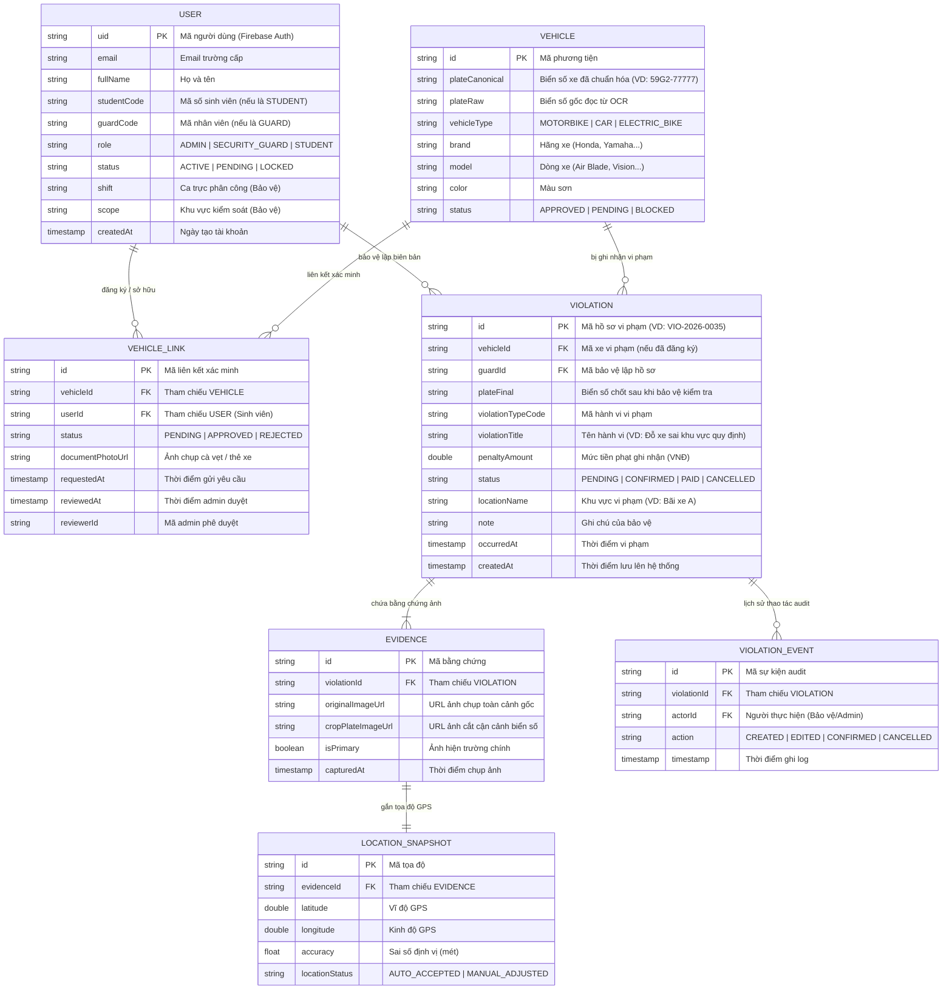
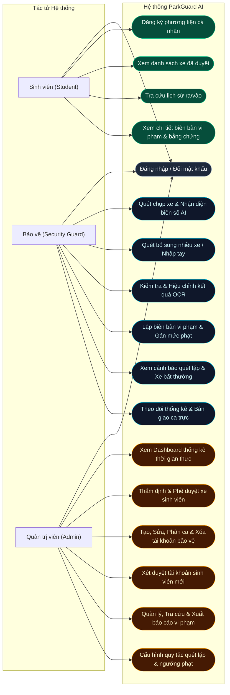
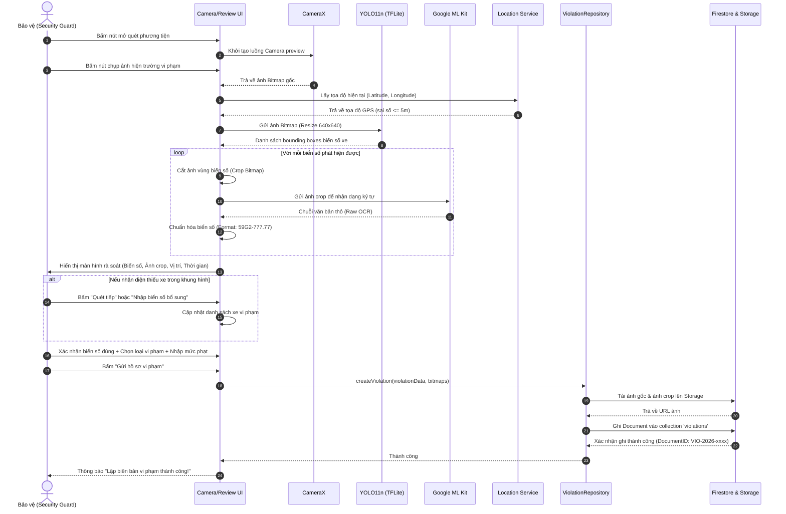
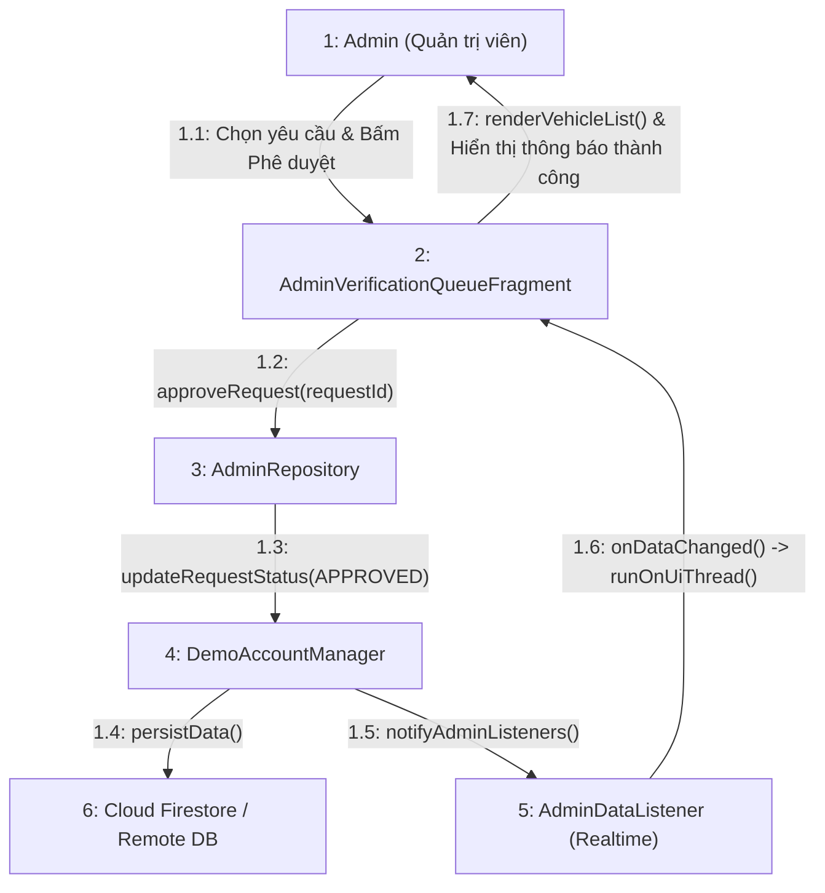
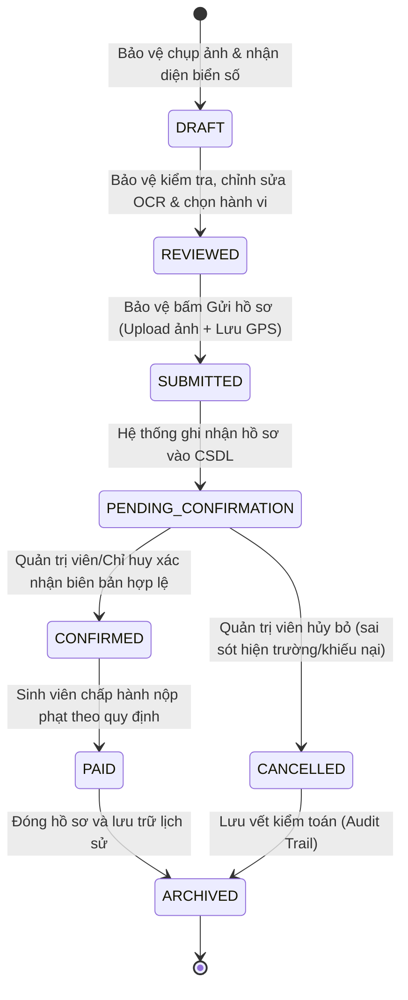
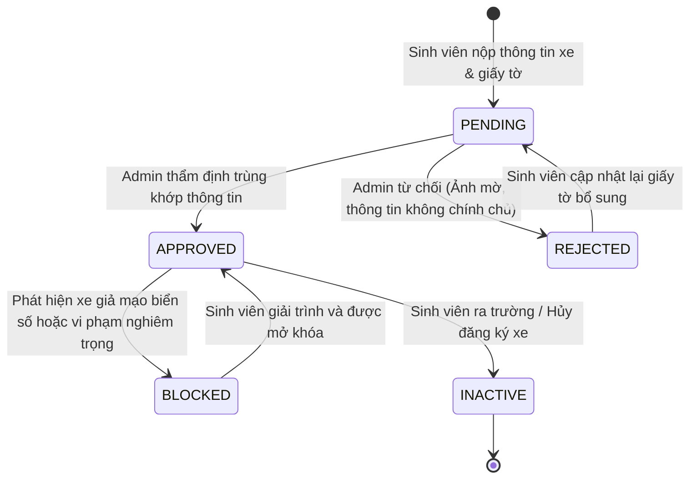
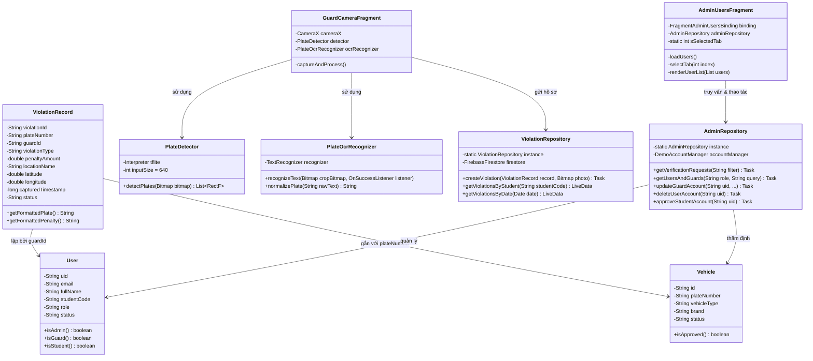
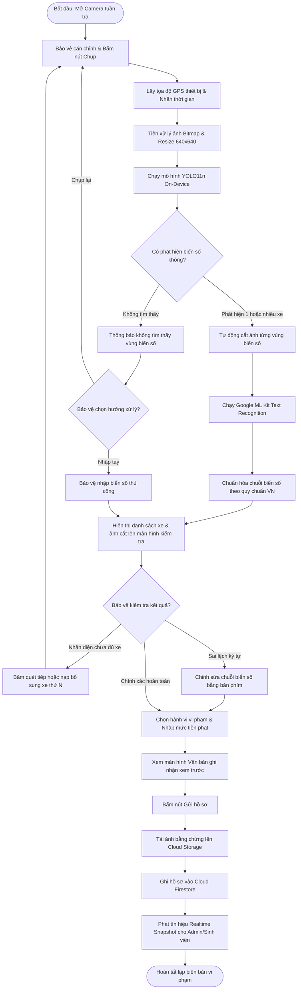

# BÁO CÁO ĐỒ ÁN MÔN HỌC / ĐỒ ÁN TỐT NGHIỆP
## ĐỀ TÀI: XÂY DỰNG ỨNG DỤNG ANDROID HỖ TRỢ NHẬN DIỆN BIỂN SỐ XE VÀ QUẢN LÝ VI PHẠM ĐỖ XE TRONG KHUÔN VIÊN TRƯỜNG ĐẠI HỌC CỬU LONG BẰNG TRÍ TUỆ NHÂN TẠO (PARKGUARD AI)

**Sinh viên thực hiện:** Nguyễn Chí Vinh — MSSV: 2411020071  
**Giảng viên hướng dẫn:** ThS. Nguyễn Chí Hiếu  
**Đơn vị:** Khoa Công nghệ Thông tin – Trí tuệ Nhân tạo, Trường Đại học Cửu Long  

---

# CHƯƠNG 3: PHÂN TÍCH VÀ THIẾT KẾ HỆ THỐNG

---

## 3.1 Yêu cầu hệ thống

Hệ thống ParkGuard AI được định hình là giải pháp di động thông minh tích hợp Trí tuệ nhân tạo (AI On-Device) nhằm hỗ trợ lực lượng bảo vệ số hóa quy trình tuần tra, kiểm tra biển số, phát hiện phương tiện lạ và lập biên bản ghi nhận vi phạm đỗ xe tại khuôn viên Trường Đại học Cửu Long. Đồng thời, hệ thống cung cấp cổng thông tin cho sinh viên để tra cứu phương tiện và cổng quản trị dành cho ban quản lý nhà trường.

### 3.1.1 Yêu cầu chức năng (Functional Requirements)

1. **Phân hệ Sinh viên (`STUDENT`):**
   - **Xác thực tài khoản:** Đăng ký tài khoản bằng email sinh viên, đăng nhập, quên mật khẩu và quản lý hồ sơ cá nhân.
   - **Đăng ký phương tiện:** Khai báo thông tin xe cá nhân (biển số, loại xe, nhãn hiệu, màu sơn, ảnh chụp giấy tờ/xe) gửi lên hệ thống ở trạng thái Chờ duyệt (`PENDING`).
   - **Tra cứu phương tiện & lịch sử:** Xem danh sách xe đã được phê duyệt (`VERIFIED`), theo dõi lịch sử các lần ra/vào và các biên bản ghi nhận vi phạm liên quan đến phương tiện chính chủ.
   - **Xem chi tiết vi phạm:** Xem hình ảnh bằng chứng hiện trường, vị trí GPS đỗ xe sai quy định, thời điểm ghi nhận, loại hành vi vi phạm và trạng thái xử lý/mức phạt.

2. **Phân hệ Nhân sự Bảo vệ (`SECURITY_GUARD`):**
   - **Chụp ảnh hiện trường thông minh (CameraX):** Giao diện quét tích hợp khung hướng dẫn, hỗ trợ chụp phương tiện vi phạm hoặc chụp quét nhanh tại cổng gác.
   - **Nhận diện biển số tự động (AI Pipeline):** Mô hình YOLO11n phát hiện vị trí biển số trên khung hình, tự động cắt ảnh (crop) và chuyển sang Google ML Kit Text Recognition để trích xuất ký tự biển số.
   - **Hỗ trợ quét đa xe (Multi-vehicle detection):** Trong trường hợp chụp ảnh khu vực có nhiều phương tiện vi phạm cùng lúc (3-4 xe), AI nhận diện toàn bộ các biển số có trong ảnh. Nếu thiếu xe, cung cấp cơ chế quét bổ sung hoặc nhập biển số thủ công vào cùng một hồ sơ vi phạm hàng loạt.
   - **Kiểm tra và hiệu chỉnh con người (Human-in-the-loop):** Bảo vệ xem lại ảnh cắt, đối chiếu biển số OCR, chỉnh sửa ký tự nếu cần, chọn danh mục hành vi vi phạm (Đỗ chắn lối thoát hiểm, đỗ sai vạch, cản trở giao thông nội bộ...).
   - **Tự động thu thập bằng chứng:** Lấy tọa độ GPS (kinh độ, vĩ độ, sai số bán kính) và nhãn thời gian chụp ảnh thực tế (`capturedAt`).
   - **Nhập mức phạt xử lý:** Hỗ trợ nhập số tiền phạt quy định hoặc chọn theo barem khung vi phạm của trường.
   - **Giám sát cảnh báo ra/vào:** Cảnh báo xe quét lại nhiều lần trong ngày, xe vào 2 lượt liên tiếp không có lượt ra (bất thường), xe lạ chưa đăng ký.
   - **Quản lý ca trực:** Xem thống kê số lượt quét trong ca, số xe hợp lệ, số xe lạ, số biên bản đã lập và bàn giao ca trực.

3. **Phân hệ Quản trị viên (`ADMIN`):**
   - **Bảng điều khiển tổng quan (Dashboard):** Thống kê số lượng vi phạm trong ngày/tuần, biểu đồ phân bố vi phạm theo khu vực (Bãi xe A, Cổng chính, Khu giảng đường), tỷ lệ xử lý hồ sơ.
   - **Quản lý danh sách vi phạm:** Tra cứu, lọc biên bản theo ngày, loại hành vi, khu vực; xác nhận hoặc hủy bỏ biên bản vi phạm; xuất dữ liệu báo cáo.
   - **Thẩm định & Duyệt phương tiện sinh viên:** Tiếp nhận hồ sơ xe do sinh viên gửi lên, đối chiếu thông tin giấy tờ, thực hiện "Duyệt nhanh" (`APPROVED`), "Từ chối" (`REJECTED`) hoặc "Khóa xe" (`BLOCKED`).
   - **Quản lý người dùng & nhân sự:**
     - *Đối với bảo vệ:* Tạo tài khoản bảo vệ, cấp quyền, chỉnh sửa thông tin (Họ tên, SĐT, Email, Ca trực, Khu vực gác), tạm đình chỉ hoặc xóa tài khoản bảo vệ.
     - *Đối với sinh viên:* Thẩm định hồ sơ đăng ký tài khoản mới (`PENDING`), phê duyệt kích hoạt, khóa hoặc xóa tài khoản.
   - **Cấu hình quy tắc nghiệp vụ:** Điều chỉnh ngưỡng gộp lần đọc trùng (30s, 60s, 120s), kích hoạt kiểm tra vào/ra xen kẽ, giới hạn số lượt vào tối đa mỗi ngày.

### 3.1.2 Yêu cầu phi chức năng (Non-Functional Requirements)

- **Hiệu năng suy luận AI (Performance):** Quá trình phát hiện vùng biển số bằng YOLO11n (.tflite) và trích xuất ký tự bằng ML Kit OCR phải thực thi trực tiếp trên thiết bị (On-Device), thời gian xử lý trung bình dưới 600ms/khung hình trên thiết bị di động phổ thông.
- **Tính chính xác và toàn vẹn dữ liệu:** Tuyệt đối không để AI tự ý kết luận hành vi vi phạm; con người (Bảo vệ/Admin) phải là người xác nhận cuối cùng trước khi ghi vào CSDL.
- **Tính thời gian thực (Real-time synchronization):** Trạng thái hồ sơ vi phạm, yêu cầu duyệt xe và danh sách nhân sự phải được cập nhật tức thì (realtime listener) giữa các thiết bị.
- **Bảo mật và Phân quyền (Security & Privacy):**
  - Mật khẩu được mã hóa an toàn qua Firebase Authentication.
  - Phân quyền chặt chẽ theo vai trò (Role-Based Access Control): Sinh viên chỉ xem được xe và vi phạm thuộc quyền sở hữu của mình; Bảo vệ chỉ lập hồ sơ; Admin nắm toàn quyền quản trị.
  - Tọa độ GPS gắn liền với thời điểm chụp ảnh gốc, chống giả mạo vị trí.
- **Giao diện người dùng (Usability & Design):** Thiết kế Dark Theme hiện đại (Dark Navy / Cyan accent), tối ưu thao tác một tay ngoài trời nắng, loại bỏ triệt để các khoảng đệm thừa, bố cục trực quan chuẩn Material 3.

---

## 3.2 Phân tích hệ thống

### 3.2.1 Thu thập yêu cầu người dùng

Thông qua khảo sát thực tế tại khuôn viên Trường Đại học Cửu Long và phỏng vấn lực lượng an ninh nội bộ:
- **Lực lượng bảo vệ:** Thường xuyên phải tuần tra các bãi xe giảng đường và các trục đường nội bộ. Việc ghi chép biển số bằng sổ tay vừa mất thời gian, vừa dễ nhầm lẫn (đặc biệt biển số 2 dòng của xe máy), khó tra cứu xem xe đó của cán bộ hay sinh viên, và không có hình ảnh bằng chứng đối chất khi người vi phạm khiếu nại.
- **Sinh viên:** Khi bị lập biên bản hoặc khóa bánh xe, sinh viên cần xem được ngay hình ảnh chứng minh xe mình đỗ ở đâu, vào lúc mấy giờ, do ai lập biên bản và mức phạt quy định là bao nhiêu để chấp hành nộp phạt minh bạch.
- **Ban Giám hiệu & Bộ phận Quản trị:** Cần số liệu thống kê trực quan về tình hình trật tự giao thông trong trường, kiểm soát danh tính những ai ra/vào trường hàng ngày, phát hiện các phương tiện lạ hoặc có dấu hiệu bất thường.

### 3.2.2 Phân tích yêu cầu người dùng

Từ các thông tin thu thập được, hệ thống cần giải quyết bài toán qua 3 trụ cột nghiệp vụ:
1. **Tự động hóa phát hiện & đọc biển số:** Ứng dụng công nghệ Computer Vision để biến chiếc điện thoại của bảo vệ thành máy quét biển số cơ động, giảm thời gian nhập liệu từ 1-2 phút xuống dưới 5 giây.
2. **Quy trình lập hồ sơ có chứng cứ pháp lý số:** Mỗi biên bản vi phạm phải bao gồm: Ảnh chụp hiện trường toàn cảnh, ảnh cắt cận cảnh biển số, chuỗi biển số đã được bảo vệ kiểm tra, tọa độ GPS vị trí vi phạm, thời gian đóng dấu điện tử và danh tính bảo vệ thụ lý.
3. **Cơ chế phân quyền 3 lớp độc lập:** Tách biệt rõ quyền hạn giữa Sinh viên, Bảo vệ và Quản trị viên để bảo vệ quyền riêng tư cá nhân và an toàn dữ liệu.

### 3.2.3 Yêu cầu phải đạt được khi thiết kế và hiện thực phần mềm

- **Kiến trúc phần mềm:** Áp dụng mô hình chuẩn MVVM (Model - View - ViewModel) và Repository Pattern, đảm bảo mã nguồn phân tách rõ ràng giữa tầng giao diện (Activity/Fragment), tầng xử lý logic và tầng dữ liệu (Firebase/Repository).
- **Công nghệ nền tảng:** Ngôn ngữ Java thuần trên nền tảng Android SDK, giao diện XML kết hợp ViewBinding (không dùng Jetpack Compose, không dùng Kotlin theo quy chuẩn đồ án).
- **Xử lý nền (Background Processing):** Tác vụ suy luận AI, xử lý ảnh Bitmap và giao tiếp mạng Firebase phải được thực thi trên Thread riêng (ExecutorService/Background Worker), tuyệt đối không gây nghẽn UI Thread (Main Thread).
- **Khả năng hoạt động ổn định:** Có cơ chế bắt lỗi ngoại lệ khi mất kết nối mạng hoặc GPS không bắt được tín hiệu; cho phép chụp lại hoặc nhập biển số thủ công khi điều kiện ánh sáng quá tối.

---

## 3.3 Thiết kế phần mềm

### 3.3.1 Thiết kế Cơ sở dữ liệu (Database Design)

Hệ thống ParkGuard AI sử dụng Cloud Firestore (NoSQL Document Store) kết hợp Firebase Storage/Cloudinary để lưu trữ dữ liệu có cấu trúc và tệp hình ảnh bằng chứng.

#### Sơ đồ Thực thể - Mối quan hệ logic (Entity Relationship Diagram)



---

### 3.3.2 Thiết kế các Use Case

Hệ thống có 3 Actor chính:
- **Sinh viên (`Student`):** Người sử dụng phương tiện cá nhân trong trường.
- **Nhân viên Bảo vệ (`Security Guard`):** Lực lượng trực tiếp tuần tra và ghi nhận vi phạm.
- **Quản trị viên (`Admin`):** Cán bộ quản lý an ninh, phê duyệt xe và phân quyền nhân sự.

#### Sơ đồ Use Case Tổng thể Hệ thống



---

### 3.3.3 Lược đồ triển khai (Deployment Diagram)

Lược đồ triển khai thể hiện cách các thành phần phần mềm được phân bố và thực thi trên các phần cứng và hạ tầng đám mây:

```mermaid
deploymentDiagram
    %% Node Thiet bi di dong
    node MobileDevice["Thiết bị Di động Android (Bảo vệ / Sinh viên / Admin)"] {
        artifact AndroidApp["Ứng dụng ParkGuard AI (APK)<br/>(Java 17, ViewBinding, MVVM)"]
        artifact YOLOModel["Mô hình AI: YOLO11n.tflite<br/>(Input 640x640, Int8/Float32)"]
        artifact MLKit["Google ML Kit Text Recognition<br/>(On-Device OCR)"]
        artifact CameraXCore["Thư viện CameraX<br/>(Camera2 API Wrapper)"]
        artifact FusedLocation["Google Play Services<br/>Fused Location Provider"]
    }

    %% Node Ha tang Backend
    node FirebaseCloud["Google Cloud / Firebase Backend Platform"] {
        node AuthNode["Firebase Authentication"] {
            component AuthAPI["Xác thực tài khoản Email/Password"]
        }
        node FirestoreNode["Cloud Firestore (NoSQL Cluster)"] {
            database BusinessDB["Dữ liệu: Users, Vehicles, Violations, Shifts"]
            component SecurityRules["Firestore Security Rules (Phân quyền 3 lớp)"]
        }
        node StorageNode["Cloudinary / Firebase Storage"] {
            storage PhotoStorage["Kho lưu trữ ảnh bằng chứng hiện trường"]
        }
    }

    %% Ket noi
    AndroidApp --> YOLOModel : TFLite Interpreter
    AndroidApp --> MLKit : Image Analysis API
    AndroidApp --> CameraXCore : Capture Image Stream
    AndroidApp --> FusedLocation : Lấy tọa độ GPS (Kinh độ/Vĩ độ)

    AndroidApp ..> AuthAPI : HTTPS / TLS 1.3
    AndroidApp ..> FirestoreNode : gRPC / Realtime Snapshot Listener
    AndroidApp ..> StorageNode : REST API / Multipart Form Upload
```

---

### 3.3.4 Lược đồ trình tự (Sequence Diagram)

#### Trình tự: Quét ảnh AI, Nhận diện và Lập hồ sơ vi phạm (Bảo vệ)



---

### 3.3.5 Lược đồ cộng tác (Communication Diagram)

Lược đồ cộng tác làm nổi bật mối quan hệ tương tác cấu trúc giữa các đối tượng trong ca sử dụng thẩm định và duyệt phương tiện của Quản trị viên:



---

### 3.3.6 Lược đồ trạng thái (State Diagram)

#### 1. Lược đồ trạng thái Hồ sơ Vi phạm (`Violation Status`)



#### 2. Lược đồ trạng thái Phương tiện đăng ký (`Vehicle Registration Status`)



---

### 3.3.7 Lược đồ lớp (Class Diagram)

Hệ thống được tổ chức theo kiến trúc MVVM:
- **Tầng View (UI):** Fragment, Activity, ViewBinding.
- **Tầng ViewModel / Presenter:** Quản lý LiveData và trạng thái UI.
- **Tầng Repository & DataSource:** Điều phối dữ liệu từ Local Model, AI Engine và Cloud Firestore.



---

### 3.3.8 Lược đồ hoạt động (Activity Diagram)

Lược đồ hoạt động mô tả tiến trình xử lý chi tiết từ khi chụp ảnh phương tiện vi phạm đến khi lưu thành công hồ sơ vào hệ thống:



---

## 3.4 Thiết kế giao diện (UI/UX Design)

Hệ thống ParkGuard AI tuân thủ nghiêm ngặt các nguyên tắc thiết kế giao diện di động hiện đại (Material Design 3 kết hợp phong cách Dark Mode chuyên dụng cho các ứng dụng an ninh/giám sát):

1. **Bảng màu chủ đạo (Color Palette):**
   - **Nền chính (Background):** `bg_navy_950` (`#070B14`) và `surface_900` (`#0C1322`) tạo cảm giác chiều sâu, chống mỏi mắt cho bảo vệ khi trực ca đêm và tăng độ tương phản hiển thị ngoài trời nắng.
   - **Màu sắc điểm nhấn (Accent Cyan):** `#00D2EE` (Cyan neon) được áp dụng cho các nút bấm hành động chính (Primary Buttons), icon trạng thái hoạt động và các nhãn quan trọng.
   - **Màu cảnh báo trạng thái (Semantic Status Colors):**
     - Xanh lá cây (`#10B981`): Trạng thái "Đang trực", "Đã duyệt", "Hợp lệ".
     - Vàng hổ phách (`#F59E0B`): Trạng thái "Chờ duyệt", "Cần xác nhận", "Xe lạ".
     - Đỏ son (`#EF4444`): Trạng thái "Tạm khóa", "Vi phạm ghi nhận", "Bị từ chối".

2. **Hệ thống điều hướng đáy (Bottom Navigation Bar):**
   - Chiều cao cố định `58dp` thanh thoát, loại bỏ hoàn toàn pill oval xám mờ mặc định của Material 3 (`itemActiveIndicatorStyle="@null"`).
   - Tối ưu hóa Window Insets: Triệt tiêu hiện tượng *double padding* với thanh điều hướng 3 nút ảo hệ thống của Android.
   - Đồng bộ 5 tab chuyên biệt cho Quản trị viên: *Tổng quan, Vi phạm, Duyệt xe, Người dùng, Cài đặt*.

3. **Cấu trúc phân vùng màn hình (Screen Layout Architecture):**
   - **Header:** Nút Back tròn 40dp + Tiêu đề trang to đậm (TitleLarge) + Nhãn mô tả phụ (Subtitle 12sp).
   - **Metric Dashboard:** Cặp thẻ tóm tắt số liệu đối xứng (2-Column Cards) bo góc 16dp, stroke 1dp, hiển thị số liệu lớn (HeadlineMedium) kèm nhãn nhỏ phía trên.
   - **Content List:** Danh sách dạng cuộn mượt mà (ScrollView / RecyclerView), các thẻ người dùng/vi phạm được bo góc 16dp với hiệu ứng phân cấp thị giác rõ ràng (Avatar tròn 44dp, Badge trạng thái, ID Tag, Nút thao tác nhanh 1 chạm).

---

## 3.5 Yêu cầu phần cứng và phần mềm

### 3.5.1 Môi trường phát triển hệ thống
- **Hệ điều hành máy tính:** Microsoft Windows 11 64-bit / macOS / Linux.
- **Môi trường phát triển tích hợp (IDE):** Android Studio Ladybug / Koala (phiên bản 2024.1 trở lên).
- **Bộ công cụ phát triển phần mềm (SDK):** Android SDK (Compile SDK: 35, Min SDK: 26 - hỗ trợ từ Android 8.0 Oreo trở lên).
- **Ngôn ngữ lập trình:** Java (JDK 17 LTS), Gradle 8.x / 9.x (Kotlin DSL cho build scripts).
- **Công cụ huấn luyện AI:** Python 3.10+, PyTorch 2.x, Ultralytics YOLO11, Google Colab (GPU NVIDIA Tesla T4).

### 3.5.2 Yêu cầu thiết bị triển khai thực tế (Target Android Devices)
- **Hệ điều hành thiết bị di động:** Android 8.0 trở lên (Android 11, 12, 13, 14 khuyến nghị).
- **Bộ vi xử lý (CPU/GPU):** Tối thiểu 8 nhân (Octa-core 2.0 GHz trở lên), hỗ trợ tập lệnh ARM64-v8a.
- **Bộ nhớ RAM:** Tối thiểu 3 GB RAM (khuyến nghị 4 GB - 8 GB RAM để đảm bảo mô hình TFLite và CameraX hoạt động trơn tru).
- **Phần cứng Camera:** Độ phân giải tối thiểu 8.0 MP, hỗ trợ Auto Focus (Tự động lấy nét).
- **Cảm biến và Kết nối:** Cảm biến định vị GPS/GLONASS, kết nối mạng 4G/5G hoặc Wi-Fi.

---

## 3.6 Liên kết giao diện (Navigation Graph & Screen Flow)

Sơ đồ liên kết màn hình thể hiện luồng chuyển đổi giữa các Fragment trong ứng dụng Android:

```mermaid
flowchart TD
    %% Màn hình khởi động & Đăng nhập
    Splash[SplashScreen / Màn hình khởi động] --> Login[LoginFragment: Đăng nhập theo Role]
    
    %% Phân luồng sau đăng nhập
    Login -- Vai trò STUDENT --> StudentHome[StudentHomeFragment: Danh sách xe của tôi]
    Login -- Vai trò SECURITY_GUARD --> GuardScan[GuardScanFragment: Quét AI & Camera]
    Login -- Vai trò ADMIN --> AdminDash[AdminDashboardFragment: Tổng quan quản trị]

    %% Luồng Sinh viên
    subgraph FlowStudent["Luồng Sinh viên (Student Portal)"]
        StudentHome --> RegVehicle[RegisterVehicleFragment: Khai báo xe mới]
        StudentHome --> StudentViolations[StudentViolationListFragment: Danh sách vi phạm]
        StudentViolations --> StudentVioDetail[ViolationDetailFragment: Xem ảnh bằng chứng & GPS]
        StudentHome --> StudentProfile[StudentProfileFragment: Tài khoản cá nhân]
    end

    %% Luồng Bảo vệ
    subgraph FlowGuard["Luồng Bảo vệ (Guard Portal)"]
        GuardScan --> CaptureReview[CaptureReviewFragment: Rà soát AI & Nhận diện đa xe]
        CaptureReview --> ConfirmReport[ConfirmReportFragment: Bản xem trước & Gửi hồ sơ]
        GuardScan --> GuardHistory[GuardHistoryFragment: Lịch sử quét trong ngày]
        GuardScan --> GuardAlerts[GuardAlertsFragment: Cảnh báo xe ra/vào bất thường]
        GuardScan --> GuardProfile[GuardProfileFragment: Thống kê ca trực & Bàn giao]
    end

    %% Luồng Admin
    subgraph FlowAdmin["Luồng Quản trị viên (Admin Portal)"]
        AdminDash --> AdminViolations[AdminViolationsFragment: Quản lý danh sách vi phạm]
        AdminDash --> AdminQueue[AdminVerificationQueueFragment: Duyệt xe sinh viên]
        AdminDash --> AdminUsers[AdminUsersFragment: Quản lý Bảo vệ & Sinh viên]
        AdminDash --> AdminMore[AdminMoreFragment: Cài đặt quy tắc quét lặp]
        
        AdminQueue --> AdminVerifDetail[AdminVerificationDetailFragment: Chi tiết thẩm định xe]
        AdminUsers --> AdminCreateGuard[AdminCreateGuardFragment: Cấp tài khoản bảo vệ]
        AdminUsers --> AdminUserDetail[AdminUserDetailFragment: Chi tiết, Sửa, Xóa & Duyệt sinh viên]
        AdminViolations --> AdminVioDetail[AdminViolationDetailFragment: Chi tiết hồ sơ & Hủy/Chốt biên bản]
    end

    %% Đăng xuất quay lại
    StudentProfile -->|Đăng xuất| Login
    GuardProfile -->|Đăng xuất| Login
    AdminMore -->|Đăng xuất| Login
```



---

*Hết Chương 3 — ParkGuard AI Project Documentation.*
